# ITV Audio Subsystem (ITV-AS)
## Technical Design Document / System Specification

| Поле | Значение |
|---|---|
| Продукт | «Интеллект X» (ITV) — платформа видеонаблюдения и безопасности |
| Подсистема | ITV Audio Subsystem (далее — **ITV-AS**) |
| Версия документа | 0.9 (draft for review) |
| Статус | На согласование архитектурного комитета |
| Дата | 2026-10-05 |
| Автор | Системная архитектура, VoIP/UC |
| Аудитория | Архитекторы, разработчики ядра/облака/мобильных приложений, DevOps, ИБ, продакт-менеджмент, оценка трудозатрат |

---

# 0. Executive Summary

**Проблема.** Сегодня в «Интеллект X» аудио — побочный продукт видеотракта: оно приходит и уходит только через готовые камеры и видеосерверы, в форматах и с ограничениями, которые диктует вендор устройства. Выделенной аудиоподсистемы не существует. В ITV Cloud есть интеграция с SIP-сервером Kamailio, но её функция узкая: веб-интерфейс для чтения и частичного изменения конфигурации плюс SIP-транспорт между домофонами и мобильным приложением. Медиа-плоскость, запись разговоров, конференции, PTT, аудиоаналитика, единая работа с микрофонами и громкоговорителями — всё это либо отсутствует, либо реализовано точечно и невоспроизводимо.

**Что предлагается.** Построить ITV-AS — аудиоподсистему с единым ядром, которое собирается в двух профилях из одного кода:
- **standalone-аудиосервер** — самостоятельный продукт/сервис, работающий вообще без видео (переговорные устройства, оповещение, диспетчерская связь, SIP-шлюз);
- **встраиваемый модуль** — библиотека `libitvaudio`, линкуемая в камеру, видеосервер или домофон, использующая аппаратные аудиовходы/выходы устройства.

**Ключевые архитектурные решения.**
1. **Разделение control plane и media plane.** Управление — stateless-сервисы с REST/gRPC; медиа — отдельные узлы (Media Node), масштабируемые независимо и не зависящие от доступности БД в момент разговора.
2. **Audio HAL** — единый C++-интерфейс устройства захвата/воспроизведения, за которым прячутся ALSA, PulseAudio/PipeWire, USB UAC, аудиовходы камер, IP-микрофоны, RTSP-аудио, SIP-терминалы и WebRTC-клиенты. Hot-plug, приоритеты, зоны, микширование — свойства HAL-слоя, а не каждого отдельного сценария.
3. **Преемственность с Kamailio.** Kamailio остаётся registrar/proxy/location — его роль не отбирается. ITV-AS подключается как пул медиа-узлов через `dispatcher`, а существующие домофоны и мобильное приложение продолжают работать без перепрошивки. Конфигурация Kamailio больше не правится файлом в обход системы: только через RPC/БД и управляемые шаблоны.
4. **SFU по умолчанию, MCU по необходимости.** Групповые сценарии строятся на маршрутизации потоков (дёшево по CPU); микширование включается только там, где клиент физически не умеет принимать несколько потоков (SIP-телефон, домофон, аналоговый громкоговоритель).
5. **Один медиа-стек на все транспорты.** RTP/SRTP, WebRTC (DTLS-SRTP/ICE), RTSP-аудио, WebSocket-аудио сходятся к общему внутреннему представлению кадра, поэтому «домофон → оператор в браузере → мобильное приложение» не требует трёх разных реализаций.

**Целевые показатели.** Mouth-to-ear ≤ 150 мс в LAN и ≤ 250 мс в облачном сценарии; установление домофонного вызова ≤ 2 с; разборчивость речи без деградации при потерях до 5 %; 500 релейных сессий на 4 vCPU; встраиваемый профиль — 2 полнодуплексных сессии при < 15 % CPU ARMv8 и < 64 МБ RAM.

**Дорожная карта.** MVP за ~4 месяца (HAL + ядро + SIP-точка-точка через Kamailio + запись + REST), далее конференции и WebRTC-шлюз, затем MCU, аналитика и внешние PBX. Суммарная грубая оценка до полного объёма — **46–66 человеко-месяцев**, детализация в разделе 16.

**Главные риски.** Бюджет CPU на дешёвых камерах (AEC — самая дорогая часть), качество эхоподавления в громкой связи домофона, лицензии на AAC/G.729, NAT-traversal в мобильных сетях и организационный риск расхождения конфигурации Kamailio между «старым» веб-интерфейсом и новым control plane. Все спорные развилки вынесены в раздел 17 как `[OPEN]` и не домыслены по ходу текста.

**Что требуется решить до старта проектирования.** Четыре развилки блокируют оценку: собственный медиа-стек против встраивания FreeSWITCH (`[OPEN-01]`); шина событий Kafka против NATS (`[OPEN-05]`); формат и место хранения записей — собственное объектное хранилище против архива «Интеллект X» (`[OPEN-09]`); модель мультитенантности в Kamailio (`[OPEN-14]`).

---

# 1. Аннотация и область применения

**Резюме.** Документ описывает архитектуру, интерфейсы и нефункциональные требования новой аудиоподсистемы ITV-AS, пригодные для начала детального проектирования и оценки трудозатрат. Подсистема покрывает весь путь звука: от физического устройства до записи в архив, от SIP-вызова домофона до группового оповещения зоны.

## 1.1. Назначение документа

Документ является источником истины для:
- принятия архитектурных решений и их защиты перед архитектурным комитетом;
- декомпозиции на эпики и оценки трудозатрат (разделы 9, 10, 16);
- согласования контрактов между командами: ядро «Интеллект X», ITV Cloud, мобильное приложение, прошивки устройств;
- постановки задач ИБ и эксплуатации (разделы 11, 12, 13).

Документ **не является**: детальным дизайном отдельных сервисов, планом тестирования, ТЗ на UI операторского места. Эти артефакты создаются после утверждения настоящей спецификации.

## 1.2. Область применения (in scope)

| Область | Содержание |
|---|---|
| Захват и воспроизведение | Единый слой абстракции аудиоустройств (HAL), hot-plug, приоритеты, зоны, микширование |
| Сигнализация | SIP UA/B2BUA, взаимодействие с Kamailio и сторонними SIP-прокси/PBX, WebRTC-сигнализация |
| Медиа | RTP/SRTP, DTLS-SRTP, транскодирование, джиттер-буфер, AEC/AGC/NS/VAD, SFU и MCU |
| Сценарии | Point-to-point, конференции, PTT/half-duplex, мониторинг, запись, оповещения, домофония |
| Управление | REST/gRPC API, события через шину сообщений, конфигурация, мультитенантность |
| Хранение | Записи разговоров и метаданные, индексация, retention, экспорт |
| Интеграции | Ядро «Интеллект X», ITV Cloud, Kamailio, мобильное приложение, внешние SIP-провайдеры |
| Профили поставки | Standalone-сервер, встраиваемый модуль, облачный кластер |

## 1.3. Вне области применения (out of scope)

- Видеотракт, видеокодеки и видеоаналитика как таковые — ITV-AS только синхронизируется с ними и потребляет/публикует события.
- Телефонная нумерация предприятия, биллинг, тарификация — остаются на стороне внешней PBX.
- Автоматическое распознавание речи (ASR) и синтез (TTS) как собственная реализация — предусмотрены точки расширения и интерфейс к внешнему движку, но собственный движок не разрабатывается. `[OPEN-11]`
- Аналоговая телефония (FXS/FXO), E1/ISDN — только через сторонний медиа-шлюз. `[ASSUMPTION]` Предполагается, что в сегменте заказчиков ITV аналоговые линии встречаются редко и покрываются сторонним шлюзом с SIP-стороной.

## 1.4. Нормативные и отраслевые ссылки

| Документ | Применение |
|---|---|
| RFC 3261, 3262, 3263, 3264, 3515, 3891, 6665 | SIP: базовый протокол, PRACK, locating servers, offer/answer, REFER, Replaces, SUBSCRIBE/NOTIFY |
| RFC 3550, 3551, 4585, 5104 | RTP/RTCP, профили AVP/AVPF, обратная связь по качеству |
| RFC 3711, 4568, 5763, 5764 | SRTP, SDES, DTLS-SRTP |
| RFC 4733 | DTMF через RTP telephone-event |
| RFC 6716, 7587 | Opus и его RTP payload format |
| RFC 8445, 5389, 5766 | ICE, STUN, TURN |
| RFC 7118 | SIP over WebSocket |
| ITU-T G.114 | Бюджет односторонней задержки речи |
| ITU-T P.862 / P.863 | PESQ / POLQA — объективная оценка качества речи |
| ITU-T G.711, G.722, G.729 | Узко- и широкополосные кодеки |
| ONVIF Profile T / Streaming Spec | Backchannel-аудио к камерам |
| ФЗ-152, GDPR | Обработка персональных данных, запись голоса |

---

# 2. Термины и сокращения

**Резюме.** Раздел фиксирует общий словарь. Особое внимание — терминам, которые в контекстах «видео» и «VoIP» означают разное (например, «канал», «поток», «сессия»).

## 2.1. Доменные термины ITV-AS

| Термин | Определение |
|---|---|
| **Audio Endpoint (AEP)** | Логическая точка входа/выхода звука: микрофон камеры, громкоговоритель, SIP-аккаунт, WebRTC-клиент, домофон. Адресуется стабильным URI `aep://<tenant>/<site>/<id>` |
| **Audio Device** | Физическое или виртуальное устройство, за которым стоит драйвер HAL. Один Device может давать несколько AEP (например, стерео-вход как два моно-AEP) |
| **Audio Session** | Логический разговор/трансляция с набором участников, политикой микширования, записи и правами. Основная единица биллинга, прав и журналирования |
| **Participant (Leg)** | Присоединение одного AEP к Audio Session с ролью и направлением (`send`, `recv`, `sendrecv`) |
| **Audio Pipeline** | Цепочка обработки внутри узла: capture → resample → DSP → encode → transport (и симметрично в обратную сторону) |
| **Media Node (MN)** | Исполнитель медиа-плоскости: терминация RTP/SRTP/WebRTC, транскодирование, SFU/MCU, подача в запись |
| **Session Controller (SC)** | Control plane: решает кто с кем и на каком узле говорит, не пропускает через себя медиа |
| **Zone** | Группа AEP для оповещения/мониторинга (этаж, периметр, проходная) |
| **Talk-back** | Односторонняя или двусторонняя речь оператора в громкоговоритель камеры |
| **Deployment Profile** | Вариант сборки и развёртывания: `embedded`, `standalone`, `cloud` |

## 2.2. Общепринятые сокращения

| Сокращение | Расшифровка |
|---|---|
| AEC / AGC / NS / VAD | Acoustic Echo Cancellation / Automatic Gain Control / Noise Suppression / Voice Activity Detection |
| ALSA | Advanced Linux Sound Architecture |
| B2BUA | Back-to-Back User Agent |
| DTLS | Datagram Transport Layer Security |
| DTMF | Dual-Tone Multi-Frequency (тональный набор) |
| HAL | Hardware Abstraction Layer |
| ICE / STUN / TURN | Протоколы обхода NAT |
| MCU | Multipoint Control Unit (сервер-микшер) |
| MOS | Mean Opinion Score (оценка качества речи 1–5) |
| mTLS | Mutual TLS |
| ONVIF | Open Network Video Interface Forum |
| PLC / FEC | Packet Loss Concealment / Forward Error Correction |
| PTT | Push-To-Talk |
| RTP / RTCP / SRTP | Real-time Transport Protocol / Control Protocol / Secure RTP |
| SBC | Session Border Controller |
| SDP | Session Description Protocol |
| SFU | Selective Forwarding Unit (сервер-маршрутизатор потоков) |
| SIP | Session Initiation Protocol |
| UAC / UAS | User Agent Client / Server |
| UAC (USB) | USB Audio Class — в документе всегда уточняется как «USB UAC» во избежание коллизии с SIP UAC |
| WebRTC | Web Real-Time Communication |

## 2.3. Соглашение о модальности требований

Используются ключевые слова RFC 2119: **ДОЛЖЕН** (MUST), **СЛЕДУЕТ** (SHOULD), **МОЖЕТ** (MAY). Требования пронумерованы как `FR-xx` (функциональные) и `NFR-xx` (нефункциональные) для трассируемости в тест-планах.

---

# 3. Текущее состояние (as-is) и ограничения

**Резюме.** Аудио в «Интеллект X» сегодня — функция устройства, а не функция платформы. Из-за этого всё, что сложнее «послушать микрофон камеры» и «позвонить с домофона в мобильное приложение», либо недостижимо, либо требует ручной работы на каждом объекте. Существующая интеграция с Kamailio ценна и должна быть сохранена, но она закрывает только сигнализацию для домофонии.

## 3.1. Как устроено сейчас

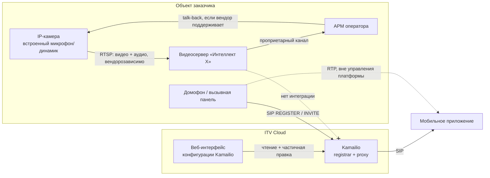

| Компонент | Что умеет сегодня | Чего не умеет |
|---|---|---|
| IP-камера | Отдаёт аудио в составе RTSP; иногда принимает backchannel | Нет единого способа управления: у каждого вендора свои кодеки, частоты дискретизации, способ включения backchannel |
| Видеосервер | Принимает аудиодорожку, пишет её вместе с видео | Не умеет инициировать разговор, микшировать, маршрутизировать звук между устройствами |
| АРМ оператора | Прослушивание и talk-back там, где это поддержал драйвер устройства | Нет конференций, PTT-групп, очереди вызовов, единого журнала разговоров |
| Домофон | Регистрируется в Kamailio, звонит в мобильное приложение | Не интегрирован с видеосервером как аудиоисточник; разговор не записывается платформой |
| Kamailio | Регистрация, маршрутизация SIP, транспорт между домофоном и приложением | Не управляет медиа-плоскостью; не знает про тенанты «Интеллект X»; конфигурация правится частично и вручную |
| Веб-интерфейс Kamailio | Чтение конфигурации, изменение части настроек | Не является API; не версионирует изменения; не обеспечивает ролевую модель уровня платформы |
| Мобильное приложение | Принимает SIP-вызов от домофона | Не получает аудио от камер и зон; не участвует в конференциях платформы |

`[ASSUMPTION]` Предполагается, что в текущей облачной интеграции медиа между домофоном и мобильным приложением идёт либо напрямую (при успешном обходе NAT), либо через внешний релей (rtpengine/TURN), но платформа не контролирует этот путь и не собирает по нему метрики качества. Это предположение требует подтверждения у команды ITV Cloud — см. `[OPEN-02]`.

## 3.2. Ограничения текущего решения

| # | Ограничение | Последствие для бизнеса |
|---|---|---|
| L-01 | Нет абстракции аудиоустройств | Каждая новая модель камеры/домофона — отдельная интеграция; сроки подключения объекта непредсказуемы |
| L-02 | Нет собственной медиа-плоскости | Нельзя гарантировать задержку, собрать MOS, доказать качество связи по SLA |
| L-03 | Невозможны групповые сценарии | Нет конференций, нет оповещения по зонам, нет диспетчерского PTT |
| L-04 | Запись аудио привязана к видеозаписи | Нельзя записать разговор домофона с мобильным приложением — видеопотока в этом канале нет |
| L-05 | Нет событийной модели для аудио | Видеоаналитика и аудио живут раздельно; «крик + движение» нельзя скоррелировать |
| L-06 | Конфигурация Kamailio правится вручную/частично | Дрейф конфигурации, отсутствие аудита, риск сломать работающую домофонию |
| L-07 | Нет мультитенантной модели в аудио | Облачное масштабирование на множество организаций упирается в изоляцию и учёт |
| L-08 | Нет единого API | Партнёрам и внутренним командам нечего интегрировать, кроме UI |
| L-09 | Эхо и уровни — на совести устройства | На громкой связи домофона качество «как повезёт», жалобы конечных пользователей |
| L-10 | Нет работы без видео | Продукт нельзя продать в нише, где нужна только связь и оповещение |

## 3.3. Что обязательно сохранить

Переход не должен ломать работающее. Фиксируем как жёсткие ограничения совместимости:

- **C-01.** Установленные домофоны продолжают работать **без перепрошивки и без изменения их SIP-настроек**.
- **C-02.** Мобильное приложение сохраняет текущий сценарий приёма вызова; изменения — только аддитивные и за feature-флагом.
- **C-03.** Kamailio остаётся registrar и location service. ITV-AS **не** реализует собственный registrar для существующих абонентов.
- **C-04.** Существующий веб-интерфейс конфигурации Kamailio продолжает работать в режиме чтения; право на запись постепенно переходит к control plane ITV-AS. `[OPEN-14]`

---

# 4. Целевое состояние (to-be) и цели

**Резюме.** ITV-AS превращает звук в полноправный управляемый ресурс платформы: с собственным API, событиями, записью, качеством под SLA и одинаковым поведением на камере, на сервере и в облаке. Один и тот же код ядра собирается в трёх профилях развёртывания.

## 4.1. Целевая картина

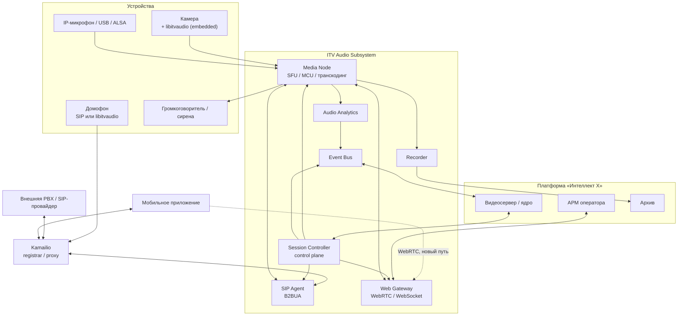

## 4.2. Цели и измеримые критерии успеха

| # | Цель | Критерий приёмки |
|---|---|---|
| G-01 | Аудио работает без видео | Standalone-инсталляция проходит полный набор сценариев раздела 8 на хосте без единой камеры |
| G-02 | Аудио работает внутри устройства | `libitvaudio` собирается под ARMv8, проходит те же сценарии на референсной камере в пределах бюджета NFR-20 |
| G-03 | Любое устройство — через один интерфейс | Добавление нового типа устройства = новый драйвер HAL без изменений в ядре, SIP и API |
| G-04 | Преемственность с Kamailio | Существующие домофоны и мобильное приложение работают без изменений на их стороне; регрессия 0 |
| G-05 | Управляемое качество | p95 mouth-to-ear и MOS соответствуют NFR-01…NFR-06 и видны в метриках |
| G-06 | Групповые сценарии | Конференция на 20 участников, PTT-группа на 100 слушателей, оповещение зоны |
| G-07 | Запись как сервис | Любой разговор записывается, индексируется, ищется по участнику/времени/событию, экспортируется |
| G-08 | Готовность к облаку | Мультитенантность, горизонтальное масштабирование медиа-узлов, SLA 99.9 % |
| G-09 | Интеграционная открытость | Публичный OpenAPI + proto + схема событий; внешняя система поднимает разговор без доступа к UI |
| G-10 | Безопасность по умолчанию | TLS/SRTP включены в дефолтной конфигурации; выключение требует явного действия и пишется в аудит |

## 4.3. Принципы проектирования

1. **Control plane никогда не на пути медиа.** Падение SC не рвёт активные разговоры; оно лишь запрещает создавать новые.
2. **Одно ядро, три профиля.** Различия между `embedded`, `standalone` и `cloud` — это набор включённых модулей и лимиты, а не разные кодовые базы.
3. **Деградация вместо отказа.** Нет Opus — переходим на G.711. Нет сети до облака — работаем локально. Нет AEC — включаем half-duplex. Каждая деградация логируется и экспортируется метрикой.
4. **Устройство — не источник истины о себе.** Платформа хранит нормализованное описание AEP; описание от устройства — лишь вход для нормализации.
5. **Всё, что произошло со звуком, — событие.** Старт/стоп разговора, DTMF, VAD, потеря качества, старт записи — публикуются в шину в едином формате.
6. **Безопасность — свойство транспорта, а не фича.** Незашифрованный RTP допустим только как явно разрешённый legacy-режим для конкретного устройства.

---

# 5. Архитектура подсистемы

**Резюме.** ITV-AS — модульная система из семи функциональных блоков с чётким разделением на плоскость управления и плоскость медиа. В профиле `embedded` часть блоков вырождается в библиотечные вызовы внутри одного процесса; в профиле `cloud` каждый блок — отдельный масштабируемый сервис. Контракты между блоками одинаковы во всех профилях, что позволяет тестировать сценарии локально и переносить в облако без переписывания.

## 5.1. Компоненты и зоны ответственности

| Компонент | Код | Ответственность | Состояние | Технология `[ASSUMPTION]` |
|---|---|---|---|---|
| Session Controller | `as-ctl` | Жизненный цикл сессий, маршрутизация, политики, права, мультитенантность, REST/gRPC API | Stateless, состояние в PostgreSQL + Redis | Go |
| Media Node | `as-mn` | RTP/SRTP/WebRTC-терминация, джиттер-буфер, транскодинг, SFU, MCU, форк в запись и аналитику | Состояние только по активным сессиям, в памяти | C++20 |
| SIP Agent | `as-sip` | SIP UA и B2BUA: REGISTER, INVITE, REFER, INFO, SUBSCRIBE/NOTIFY; взаимодействие с Kamailio и внешними прокси | Диалоги в памяти + реплика в Redis | C++20 / pjproject |
| Web Gateway | `as-wgw` | WebRTC-сигнализация, SIP over WebSocket, ICE/DTLS, аутентификация веб- и мобильных клиентов | Stateless | Go + libwebrtc-биндинги |
| Recorder | `as-rec` | Приём форка медиа, сегментация, упаковка, выгрузка в хранилище, индексация | Буфер на диске | Go / C++ |
| Audio Analytics | `as-aa` | VAD, детекторы акустических событий, подготовка признаков, хуки к внешним ASR/TTS | Stateless | C++ / Python-воркеры |
| Device Manager | `as-dev` | Реестр устройств и AEP, hot-plug, health, нормализация возможностей, профили | Stateless, PostgreSQL | Go |
| Audio Engine (библиотека) | `libitvaudio` | HAL + pipeline + кодеки + SRTP; встраивается в `as-mn` и в прошивку устройства | — | C++20 |

**Почему так.** Media Node и SIP Agent разделены намеренно: сигнализация и медиа масштабируются по разным законам. Один SIP Agent обслуживает тысячи диалогов на скромном CPU, тогда как медиа упирается в ядра и сеть. Объединение их в один процесс (как в классическом Asterisk) упростило бы MVP, но зафиксировало бы потолок масштабирования и сделало бы перезапуск сигнализации разрывом разговоров.

## 5.2. C4 — Уровень 1: Контекст

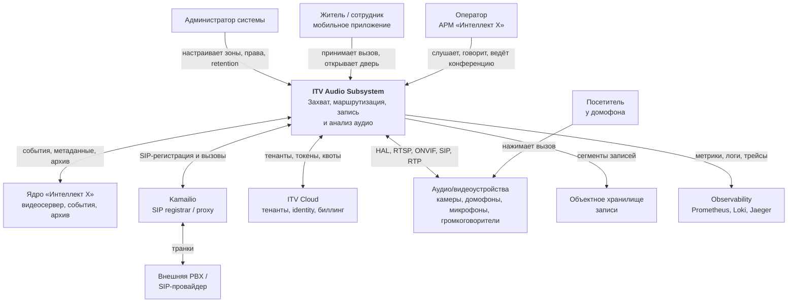

**Границы ответственности.** ITV-AS владеет звуком и всем, что с ним происходит. Он **не** владеет: идентификацией пользователей (это ITV Cloud/identity), видеопотоком (ядро «Интеллект X»), SIP-регистрациями существующих абонентов (Kamailio), долговременным хранением (объектное хранилище/архив).

## 5.3. C4 — Уровень 2: Контейнеры

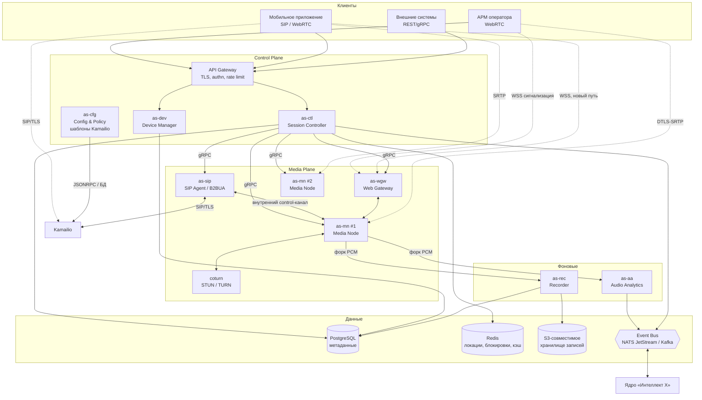

> Примечание: в блоке выше связь `as-sip ↔ as-mn` — внутренний control-канал (gRPC) для аллокации медиа-ресурсов и обмена SDP.

### Контракты между контейнерами

| От | К | Протокол | Назначение | Критичность |
|---|---|---|---|---|
| Клиент | API Gateway | HTTPS/REST, gRPC-web | Управление | Высокая |
| as-ctl | as-mn | gRPC/mTLS | Allocate/modify/release медиа-ресурса | Критическая |
| as-ctl | as-sip | gRPC/mTLS | Инициация и управление вызовами | Критическая |
| as-sip | Kamailio | SIP/TLS 5061, SIP/UDP 5060 (legacy) | Сигнализация | Критическая |
| as-mn ↔ устройство | SRTP/RTP, ICE | Медиа | Критическая |
| as-mn | as-rec | gRPC-stream или shared memory | Форк PCM/Opus | Средняя (деградирует без разрыва) |
| as-* | Event Bus | NATS/Kafka | События | Средняя |
| as-cfg | Kamailio | JSONRPC-S / БД | Управляемая конфигурация | Средняя |

## 5.4. C4 — Уровень 3: Компоненты Media Node

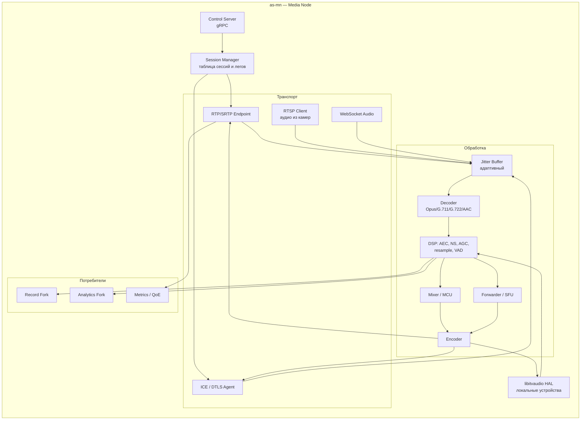

**Ключевое решение по конвейеру.** SFU-путь (`FWD`) не декодирует звук: пакеты пересылаются как есть, что даёт минимальную задержку и почти нулевую стоимость CPU. Декодирование включается только когда нужно микширование, транскодирование, запись в общий файл или аналитика. Это значит, что включение записи конференции **повышает** нагрузку на узел — и это должно учитываться в планировании ёмкости (см. 13.2).

## 5.5. C4 — Уровень 3: Компоненты Session Controller

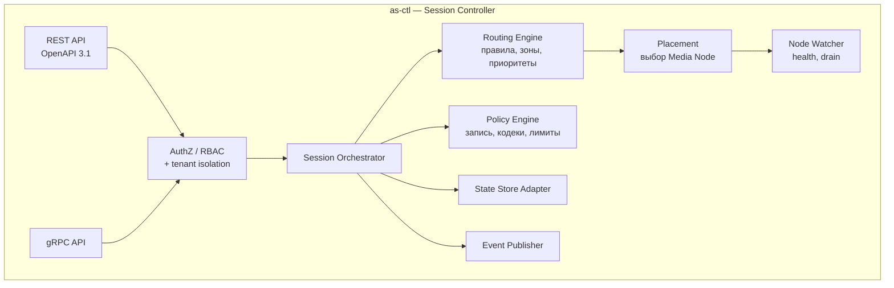

## 5.6. Варианты развёртывания

### 5.6.1. Профиль `embedded` — внутри устройства

Назначение: камера, домофон, видеосервер малой ёмкости. Один процесс, нет внешних зависимостей, работа при обрыве связи с облаком.

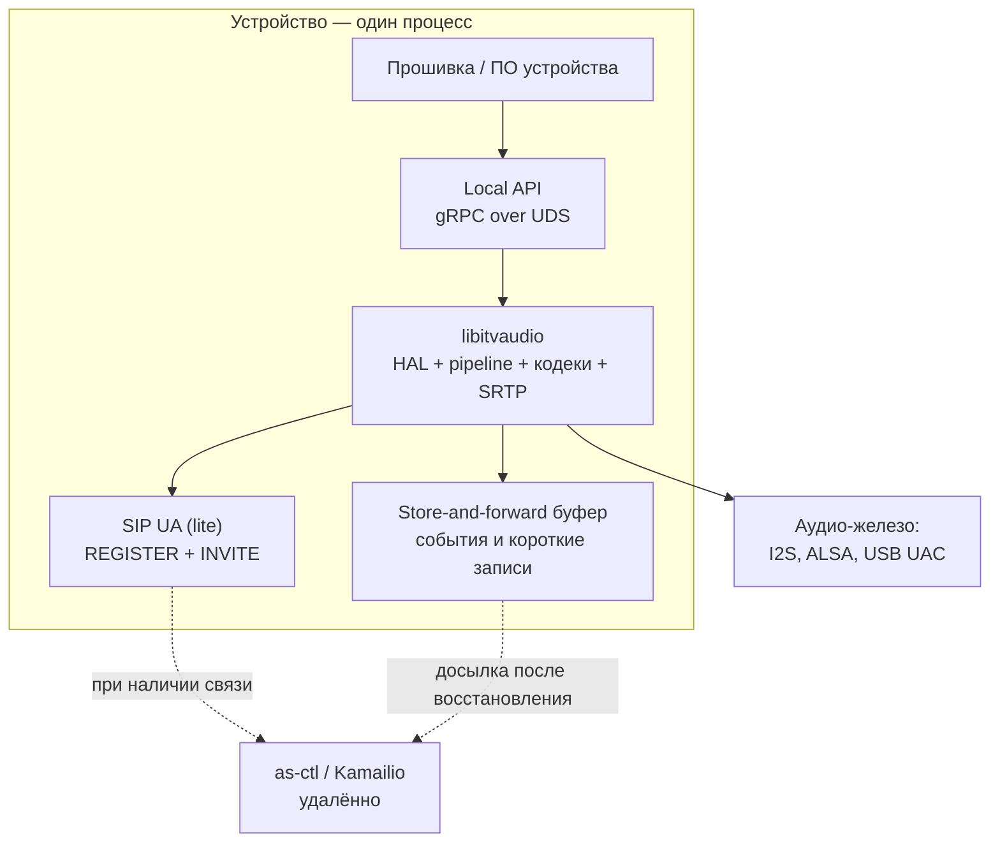

| Параметр | Значение |
|---|---|
| Включённые модули | HAL, pipeline, Opus/G.711/G.722, SRTP, SIP UA lite, локальное API |
| Исключено | SFU/MCU, транскодинг-матрица, Recorder (кроме кольцевого буфера), аналитика (кроме VAD) |
| Бюджет | ≤ 64 МБ RAM, ≤ 15 % CPU ARMv8 @1 ГГц на 2 полнодуплексные сессии |
| Автономность | Полная для point-to-point и локального PTT; зависимость от облака только для регистрации и политики |
| Обновление | В составе прошивки; ABI библиотеки версионируется семантически |

`[ASSUMPTION]` Предполагается наличие на целевых устройствах Linux-окружения с ALSA. Для устройств на RTOS потребуется отдельный порт HAL — объём не оценивается в этой версии документа. `[OPEN-07]`

### 5.6.2. Профиль `standalone` — самостоятельный аудиосервер

Назначение: объект без видео или с видео стороннего вендора; «коробка», которую можно поставить и продать отдельно.

| Параметр | Значение |
|---|---|
| Состав | Все сервисы в docker-compose на одном хосте; PostgreSQL и NATS локально; записи на локальный диск или NAS |
| Kamailio | Опционально локальный (встроенный в поставку) либо внешний |
| Ёмкость `[ASSUMPTION]` | До 200 одновременных сессий на 8 vCPU / 16 ГБ RAM / SSD |
| Отказоустойчивость | Одиночный узел; опционально active-passive пара с VRRP |
| Сеть | Один публичный адрес, диапазон RTP-портов 16384–32768 |

### 5.6.3. Профиль `cloud` — ITV Cloud

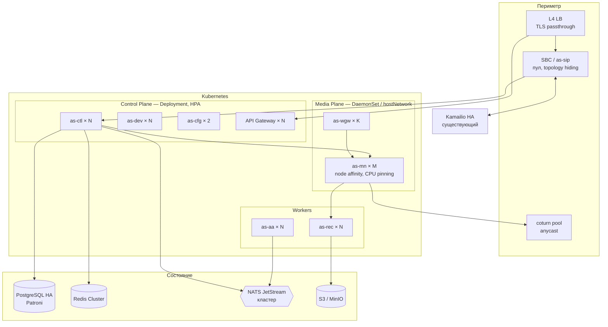

| Параметр | Значение |
|---|---|
| Мультитенантность | Логическая: `tenant_id` во всех сущностях, RLS в PostgreSQL, отдельные SIP-домены, квоты на сессии и хранилище |
| Медиа-узлы | `hostNetwork: true` — иначе NAT в CNI ломает RTP-производительность и ICE; CPU pinning для DSP-потоков |
| Масштабирование | Control plane — по RPS и CPU; Media Node — по числу активных легов и загрузке сети (кастомная метрика HPA) |
| Георазнесение | Media Node размещаются ближе к устройствам; выбор узла по RTT и региону тенанта |
| Обновления | Media Node — только drain-and-replace: узел перестаёт принимать новые сессии и выводится после завершения последней |

### 5.6.4. Сводное сравнение профилей

| Возможность | `embedded` | `standalone` | `cloud` |
|---|---|---|---|
| HAL и локальные устройства | ✅ | ✅ | ограниченно |
| Point-to-point SIP | ✅ | ✅ | ✅ |
| Конференция SFU | ❌ | ✅ | ✅ |
| Конференция MCU | ❌ | ✅ (до 8 участников) | ✅ |
| PTT-группа | локальная | ✅ | ✅ |
| Запись | кольцевой буфер | ✅ локально | ✅ в объектное хранилище |
| Аудиоаналитика | VAD | базовые детекторы | полный набор |
| Мультитенантность | ❌ | опционально | ✅ |
| HA | ❌ | active-passive | ✅ |
| Работа без связи с облаком | ✅ | ✅ | неприменимо |

---

# 6. Слой абстракции аудиоустройств

**Резюме.** HAL — центральное архитектурное решение документа. Он сводит принципиально разные источники звука (локальная звуковая карта, аудиовход камеры, SIP-телефон, WebRTC-браузер) к одному интерфейсу с одинаковой семантикой открытия, чтения, записи, hot-plug и приоритетов. Благодаря этому все сценарии раздела 8 пишутся один раз и работают с любым устройством.

## 6.1. Модель

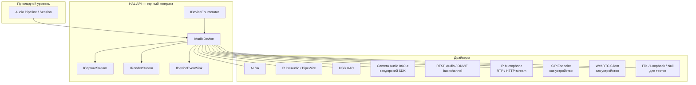

**Важное следствие.** SIP-терминал и WebRTC-клиент реализованы как драйверы HAL, а не как особый случай в ядре. Для pipeline «микрофон камеры» и «входящий SIP-вызов» — одинаковые источники кадров. Это убирает ветвления из всех сценариев и даёт бесплатную комбинируемость: например, записать в файл поток из домофона так же просто, как с USB-микрофона.

## 6.2. Контракт HAL (C++)

```cpp
namespace itv::audio::hal {

enum class SampleFormat { S16LE, S32LE, F32LE };
enum class DeviceKind   { Capture, Render, Duplex };
enum class Transport    { Local, Network, Virtual };

struct AudioFormat {
    uint32_t     sample_rate_hz;   // 8000 | 16000 | 32000 | 48000
    uint8_t      channels;         // 1..8
    SampleFormat format;
    uint16_t     frame_ms;         // 10 | 20 | 40
};

struct DeviceCapabilities {
    std::vector<AudioFormat> formats;
    bool supports_hw_aec   = false;  // эхоподавление в железе
    bool supports_hw_gain  = false;
    bool supports_duplex   = false;
    bool is_hotpluggable   = false;
    uint16_t min_latency_ms = 0;     // достижимый минимум буфера
};

struct DeviceDescriptor {
    std::string        uri;          // "hal://alsa/hw:1,0", "hal://onvif/cam-42/backchannel"
    std::string        stable_id;    // переживает перезагрузку и переподключение
    std::string        display_name;
    DeviceKind         kind;
    Transport          transport;
    DeviceCapabilities caps;
    std::map<std::string, std::string> attributes; // vendor, serial, zone, site
};

struct AudioFrame {
    const uint8_t* data;
    size_t         bytes;
    AudioFormat    format;
    uint64_t       pts_ns;        // монотонная временная метка источника
    uint64_t       ntp_ts;        // для синхронизации с видео через RTCP SR
    uint32_t       sequence;
    bool           silence;       // определено VAD или DTX
};

class ICaptureStream {
public:
    virtual ~ICaptureStream() = default;
    // Блокирующее чтение с таймаутом; возвращает число кадров или код ошибки.
    virtual Result<AudioFrame> Read(std::chrono::milliseconds timeout) = 0;
    virtual Result<void>       SetGain(float db) = 0;
    virtual Stats              GetStats() const = 0;   // xruns, dropped, level_dbfs
};

class IRenderStream {
public:
    virtual ~IRenderStream() = default;
    virtual Result<void> Write(const AudioFrame& frame) = 0;
    virtual Result<void> SetVolume(float db) = 0;
    virtual uint32_t     GetBufferedMs() const = 0;
    virtual Result<void> Flush() = 0;                  // сброс при смене говорящего в PTT
};

class IAudioDevice {
public:
    virtual ~IAudioDevice() = default;
    virtual const DeviceDescriptor& Descriptor() const = 0;
    virtual Result<void> Open(const AudioFormat& fmt, OpenFlags flags) = 0;
    virtual Result<void> Close() = 0;
    virtual Result<std::shared_ptr<ICaptureStream>> Capture() = 0;
    virtual Result<std::shared_ptr<IRenderStream>>  Render() = 0;
    virtual HealthState  Health() const = 0;           // Ok | Degraded | Lost
};

class IDeviceEventSink {
public:
    virtual void OnDeviceArrived(const DeviceDescriptor&) = 0;
    virtual void OnDeviceRemoved(const std::string& stable_id) = 0;
    virtual void OnDeviceStateChanged(const std::string& stable_id, HealthState) = 0;
    virtual void OnFormatChanged(const std::string& stable_id, const AudioFormat&) = 0;
};

class IDeviceEnumerator {
public:
    virtual std::vector<DeviceDescriptor> Enumerate(DeviceKind kind) = 0;
    virtual Result<std::shared_ptr<IAudioDevice>> Acquire(const std::string& uri,
                                                          Priority priority) = 0;
    virtual void Subscribe(IDeviceEventSink* sink) = 0;
};

} // namespace itv::audio::hal
```

**FR-01.** Каждый драйвер HAL ДОЛЖЕН реализовать полный контракт `IAudioDevice`; неподдерживаемые операции возвращают `Result::Unsupported`, но не приводят к неопределённому поведению.
**FR-02.** `stable_id` ДОЛЖЕН сохраняться между переподключениями устройства и перезагрузками хоста. Для USB — из serial + VID/PID, для сетевых — из MAC/серийного номера, для ALSA без serial — из пути в sysfs. `[ASSUMPTION]` Для дешёвых USB-микрофонов без уникального серийного номера возможны коллизии; в этом случае `stable_id` строится из физического порта, и перестановка устройства между портами считается новым устройством.

## 6.3. Матрица драйверов

| Драйвер | Источник | Транспорт | Hot-plug | Дуплекс | Задержка `[ASSUMPTION]` | Приоритет реализации |
|---|---|---|---|---|---|---|
| `alsa` | Звуковые карты Linux, I2S | Local | через udev | ✅ | 10–30 мс | MVP |
| `usb-uac` | USB Audio Class 1/2 | Local | через udev | ✅ | 15–40 мс | MVP |
| `pulse` / `pipewire` | Десктопные хосты | Local | ✅ | ✅ | 20–60 мс | Фаза 2 |
| `camera-sdk` | Аудиовход/выход камеры «Интеллект X» | Local | ✅ | зависит от модели | 20–50 мс | MVP (референсная модель) |
| `rtsp-audio` | Аудиодорожка RTSP | Network | по health | только приём | 100–400 мс | MVP |
| `onvif-backchannel` | ONVIF Profile T backchannel | Network | по health | только передача | 100–300 мс | Фаза 2 |
| `ip-mic` | IP-микрофон RTP/multicast | Network | по health | только приём | 30–80 мс | Фаза 2 |
| `sip-endpoint` | SIP-терминал, домофон | Network | по регистрации | ✅ | 40–120 мс | MVP |
| `webrtc-client` | Браузер, мобильное приложение | Network | по сигнализации | ✅ | 30–100 мс | Фаза 2 |
| `file` / `null` / `loopback` | Тесты и оповещения из файлов | Virtual | — | — | — | MVP |

## 6.4. Обнаружение и горячее подключение

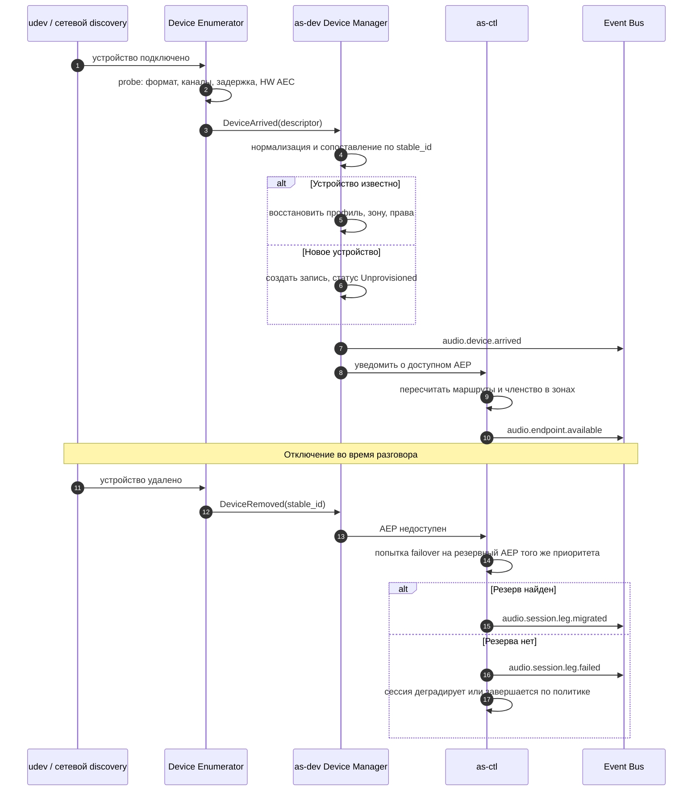

**FR-03.** Отключение устройства во время активной сессии НЕ ДОЛЖНО приводить к падению процесса. Обязательна корректная деградация: попытка failover, иначе — закрытие лега с событием.
**FR-04.** Обнаружение сетевых аудиоустройств СЛЕДУЕТ выполнять через ONVIF WS-Discovery, mDNS и явное добавление по адресу.

## 6.5. Приоритеты, арбитраж и зоны

Несколько сценариев могут претендовать на одно устройство: оператор говорит в громкоговоритель, и одновременно срабатывает автоматическое оповещение о пожаре. Арбитраж — обязанность HAL-слоя, а не прикладного кода.

| Уровень | Название | Пример | Поведение при конфликте |
|---|---|---|---|
| 100 | `emergency` | Пожарное оповещение, тревога | Вытесняет всё, остальные ставятся на паузу |
| 80 | `live_call` | Активный двусторонний разговор | Вытесняет мониторинг и фоновые задачи |
| 60 | `announcement` | Плановое голосовое объявление | Ждёт завершения `live_call`, либо микшируется с ducking |
| 40 | `monitoring` | Пассивное прослушивание | Не вытесняет никого, всегда уступает |
| 20 | `background` | Фоновая музыка, тестовые тоны | Вытесняется любым уровнем выше |

```
FUNCTION acquire(device_uri, requester_priority, mixing_policy):
    current = registry.active_holder(device_uri)

    IF current IS NULL:
        RETURN grant(device_uri, requester)

    IF device.supports_mixing AND mixing_policy == MIX:
        RETURN grant_shared(device_uri, requester, duck_db = -12)

    IF requester_priority > current.priority:
        emit_event("audio.device.preempted", victim = current)
        suspend(current)                 // лег не рвётся, ставится на hold
        RETURN grant(device_uri, requester)

    IF requester_priority == current.priority:
        RETURN queue_or_reject(by_policy)   // FIFO-очередь либо отказ

    RETURN reject(reason = "busy_higher_priority")
```

**FR-05.** Вытеснение НЕ ДОЛЖНО разрывать вытесняемую сессию, если она может быть поставлена на паузу. После освобождения устройства приостановленная сессия автоматически возобновляется.
**FR-06.** Zone — именованная группа AEP; операция над зоной применяется ко всем доступным участникам, недоступные фиксируются в результате операции как частичный отказ.

## 6.6. Микширование и нормализация формата

Между разнородными устройствами всегда есть рассогласование: 8 кГц у SIP-телефона, 48 кГц у WebRTC, 16 кГц у камеры. Внутреннее представление фиксировано.

| Параметр внутреннего формата | Значение | Обоснование |
|---|---|---|
| Частота дискретизации | 48 000 Гц | Нативна для Opus и WebRTC; downsample дешевле upsample-артефактов |
| Формат отсчётов | `float32` в конвейере, `S16LE` на границах | Избегаем клиппинга при суммировании |
| Размер кадра | 20 мс (960 отсчётов) | Компромисс задержка/накладные расходы; совместим с Opus и G.711 |
| Каналы | Моно | Речь; стерео только при явном включении на запись |

```
FUNCTION mix(frames[], output_format):
    accumulator = zeros(frame_size, float32)
    active = filter(frames, f -> NOT f.silence)      // VAD-gating экономит CPU

    IF count(active) == 0: RETURN silence_frame()
    IF count(active) == 1: RETURN convert(active[0], output_format)

    FOR each f IN active:
        resampled = resample(f, 48000)
        accumulator += resampled.samples * f.gain

    // Мягкое ограничение вместо жёсткого клиппинга
    accumulator = soft_limiter(accumulator, threshold_dbfs = -1.0)
    // N-1: участник не слышит себя
    RETURN convert(accumulator, output_format)
```

**FR-07.** Для конференций ДОЛЖЕН применяться принцип N-1: каждому участнику отдаётся микс без его собственного вклада.
**FR-08.** Число одновременно микшируемых активных говорящих СЛЕДУЕТ ограничивать (по умолчанию 3 громчайших по VAD) — это снижает шум и стоимость CPU без заметной потери для слушателей.

## 6.7. Обработка сигнала (DSP)

| Модуль | Когда применяется | Примечание |
|---|---|---|
| AEC | Громкая связь: домофон, talk-back, АРМ без гарнитуры | Самый дорогой модуль по CPU. При наличии аппаратного AEC — использовать его. На слабых устройствах fallback в half-duplex |
| NS | Шумные среды: улица, проходная | Агрессивность настраивается профилем устройства |
| AGC | Все микрофонные источники | Целевой уровень −18 dBFS |
| VAD | Везде | Нужен и для DTX, и для аналитики, и для gating в миксере |
| Resampler | На границах форматов | Качество «speech» на embedded, «high» на сервере |
| Comfort Noise | При DTX | Иначе пользователь считает, что связь оборвалась |

`[ASSUMPTION]` В качестве базовой реализации DSP предполагается использование модулей WebRTC Audio Processing (AEC3, NS, AGC2) как наиболее зрелых и проверенных в реальных условиях. Альтернатива — SpeexDSP (легче, но заметно хуже AEC). Окончательный выбор зависит от замеров на референсном устройстве. `[OPEN-06]`

---

# 7. SIP-подсистема и интеграция с Kamailio

**Резюме.** Kamailio остаётся тем, чем он является сегодня, — registrar и SIP-прокси. ITV-AS добавляется рядом как управляемый пул медиа-узлов и B2BUA. Существующие домофоны и мобильное приложение продолжают регистрироваться там же и теми же учётными данными; изменения касаются только маршрутизации на стороне Kamailio и выполняются через контролируемые шаблоны конфигурации.

## 7.1. Разделение ролей

| Функция | Kamailio | ITV-AS (`as-sip`) |
|---|---|---|
| REGISTER абонентов, location service | ✅ владелец | только проксирует свои собственные аккаунты |
| Аутентификация абонентов (digest) | ✅ владелец | — |
| Маршрутизация INVITE | ✅ владелец | принимает то, что пришло |
| Балансировка на медиа-узлы | ✅ через `dispatcher` | публикует health для dispatcher |
| Медиа-терминация, SRTP | — | ✅ владелец |
| Транскодирование, микширование | — | ✅ владелец |
| Запись разговора | — | ✅ владелец |
| NAT traversal | частично (`nathelper`) | ICE/TURN, латчинг RTP |
| Внешние транки к PBX | ✅ владелец | медиа для транков |
| B2BUA, подмена сторон, перевод | — | ✅ владелец |

**Почему B2BUA, а не только прокси.** Запись, конференции, перевод вызова и подмена кодеков требуют контроля обеих ног вызова. Kamailio как прокси по своей природе не держит медиа и не может этого дать. Поэтому `as-sip` терминирует вызов с обеих сторон, что также даёт topology hiding и защиту от прямого доступа к медиа-узлам.

## 7.2. Схема сигнализации

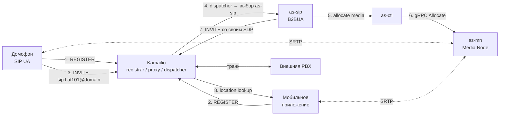

## 7.3. Конфигурация Kamailio: что добавляется

Изменения минимальны и аддитивны. Ниже — псевдокод фрагмента `kamailio.cfg`, генерируемого из шаблона сервисом `as-cfg`.

```
# --- Блок ITV-AS, управляемый as-cfg. Правки вручную будут перезаписаны. ---
loadmodule "dispatcher.so"
loadmodule "jsonrpcs.so"
loadmodule "htable.so"

modparam("dispatcher", "db_url", DBURL)
modparam("dispatcher", "ds_ping_method", "OPTIONS")
modparam("dispatcher", "ds_probing_mode", 1)
modparam("dispatcher", "ds_ping_interval", 10)

route[ITV_AUDIO_ROUTE] {
    # Признак того, что вызов должен идти через аудиоподсистему
    if (is_audio_subsystem_target()) {           # по domain, по префиксу или по htable-флагу
        if (!ds_select_dst("1", "4")) {          # группа 1 = пул as-sip, алгоритм 4 = по нагрузке
            send_reply("503", "Audio subsystem unavailable");
            exit;
        }
        xlog("L_INFO", "ITV-AS: routing $ci to $du\n");
        t_on_failure("ITV_AUDIO_FAILOVER");
        route(RELAY);
        exit;
    }
    # Иначе — существующая логика без изменений
}

failure_route[ITV_AUDIO_FAILOVER] {
    if (t_is_canceled()) exit;
    if (t_check_status("5[0-9][0-9]")) {
        if (ds_next_dst()) { t_relay(); exit; }   # следующий узел пула
    }
    # Критично для преемственности: при полном отказе ITV-AS
    # домофония деградирует к прежней прямой схеме
    route(LEGACY_DIRECT_ROUTE);
}
```

**FR-09.** При недоступности всего пула `as-sip` Kamailio ДОЛЖЕН откатываться к прежней прямой маршрутизации между домофоном и мобильным приложением. Отсутствие аудиоподсистемы не должно означать отсутствие домофонии. Это главная гарантия безопасного внедрения.
**FR-10.** Конфигурация Kamailio ДОЛЖНА управляться через шаблоны и применяться через JSONRPC/БД с версионированием и возможностью отката. Ручное редактирование файла допускается только в аварийном режиме и фиксируется в аудите.

`[ASSUMPTION]` Предполагается, что текущий `kamailio.cfg` допускает добавление route-блока без конфликта с существующей логикой и что используется БД-бэкенд (MySQL/PostgreSQL) для `location`/`subscriber`. Требуется ревизия действующего конфига перед оценкой. `[OPEN-02]`

## 7.4. Поддерживаемые SIP-методы и расширения

| Метод / расширение | Поддержка | Назначение в ITV-AS |
|---|---|---|
| REGISTER | UAC | Регистрация собственных аккаунтов ITV-AS (камеры, зоны, сервисные номера) |
| INVITE / ACK / BYE / CANCEL | UAC + UAS | Базовый вызов |
| re-INVITE / UPDATE | ✅ | Hold/unhold, смена кодека, добавление в конференцию |
| REFER + Replaces | ✅ | Перевод вызова: attended и blind |
| INFO | ✅ | DTMF (legacy), команды устройствам |
| OPTIONS | ✅ | Keep-alive и health для dispatcher |
| PRACK (100rel) | ✅ | Надёжные предварительные ответы, важно для early media |
| SUBSCRIBE / NOTIFY | ✅ | Presence устройств, BLF, статус дверей |
| MESSAGE | MAY | Текстовые уведомления; низкий приоритет |
| PUBLISH | MAY | Публикация статуса AEP |

## 7.4.1. Кодеки

| Кодек | Частота | Битрейт | Применение | Приоритет |
|---|---|---|---|---|
| Opus | 8–48 кГц | 6–510 кбит/с | Основной: WebRTC, мобильное приложение, внутренние транки. FEC + DTX | 1 |
| G.722 | 16 кГц | 64 кбит/с | Широкополосные SIP-телефоны и домофоны | 2 |
| G.711 A-law | 8 кГц | 64 кбит/с | Универсальный fallback, РФ и ЕС | 3 |
| G.711 µ-law | 8 кГц | 64 кбит/с | Fallback, Северная Америка, часть оборудования | 4 |
| AAC-LC / AAC-LD | 16–48 кГц | 32–128 кбит/с | Совместимость с видеотрактом и архивом; AAC-LD для низкой задержки | 5 |
| L16 | 48 кГц | 768 кбит/с | Внутренние каналы в пределах узла и запись без потерь | внутр. |
| G.729 | 8 кГц | 8 кбит/с | Только при требовании заказчика | `[OPEN-04]` лицензирование |

**FR-11.** Порядок предложения кодеков в SDP ДОЛЖЕН определяться профилем устройства, а не глобальной настройкой: домофону предлагается G.722/G.711, мобильному приложению — Opus.
**FR-12.** Транскодирование ДОЛЖНО включаться только при отсутствии общего кодека. Система обязана экспортировать метрику доли транскодируемых сессий — её рост означает неоптимальную конфигурацию профилей.

## 7.4.2. DTMF

Три механизма с приоритетом согласования: **RFC 4733** (telephone-event в RTP) → **SIP INFO** → **inband-детекция**. Inband — последний рубеж, он требует декодирования и чувствителен к кодеку с потерями.

**FR-13.** Любое полученное DTMF-событие ДОЛЖНО публиковаться в шину как `audio.dtmf.received` вне зависимости от механизма. Сценарий «открыть дверь по коду» строится на событии, а не на конкретном транспорте DTMF.

## 7.4.3. Hold, Transfer, ранняя медиа

| Операция | Реализация |
|---|---|
| Hold | re-INVITE с `a=sendonly` (или `a=inactive`); воспроизведение music-on-hold по политике |
| Unhold | re-INVITE с `a=sendrecv` |
| Blind transfer | REFER без Replaces; B2BUA создаёт новый лег и сшивает |
| Attended transfer | REFER с Replaces; B2BUA заменяет существующий диалог |
| Early media | 183 Session Progress + SDP; применяется для предпросмотра звука от домофона до ответа |
| Call waiting | Политика на уровне AEP: отклонить, поставить в очередь или принять второй вызов |

## 7.5. Безопасность SIP и медиа

| Слой | Решение |
|---|---|
| Сигнализация | SIP over TLS 1.2+ (порт 5061). UDP 5060 — только для перечисленных legacy-устройств, в явном allow-list |
| Медиа SIP | SRTP AES-128-GCM (предпочтительно) или AES-CM-128-HMAC-SHA1-80; ключи через SDES (`RTP/SAVP`) |
| Медиа WebRTC | DTLS-SRTP обязателен |
| Смешанные вызовы | B2BUA терминирует SRTP с обеих сторон; допустим «SDES ↔ DTLS-SRTP» мост |
| Аутентификация | Digest в Kamailio; mTLS между `as-sip` и `as-ctl` |
| Защита от fraud | Лимиты вызовов на AEP и тенант, allow-list направлений, детекция аномалий по частоте и длительности |
| Topology hiding | B2BUA не раскрывает внутренние адреса медиа-узлов во внешнем SDP |

`[OPEN-03]` Требуется решение, допускается ли вообще незашифрованный RTP для старых домофонов, или на них распространяется обязательное обновление/замена. Это и продуктовый, и ИБ-вопрос.

## 7.6. Интеграция с внешними SIP-провайдерами и PBX

Транки терминируются на Kamailio, медиа — на ITV-AS. Поддерживаются: регистрация транка по логину/паролю, транк по IP-авторизации, SRV-балансировка, переопределение Caller ID, преобразование номеров (dialplan), failover между провайдерами.

**FR-14.** Для каждого транка ДОЛЖЕН настраиваться независимый профиль кодеков, DTMF и NAT.

---

# 8. Сценарии использования

**Резюме.** Раздел описывает восемь ключевых сценариев с sequence-диаграммами. Сценарии покрывают оба режима работы — с видео и без — и обе плоскости: SIP и WebRTC. Каждый сценарий привязан к целям раздела 4 и служит основой для приёмочных тестов.

## 8.1. Каталог сценариев

| # | Сценарий | Акторы | Профили | Цель | Фаза |
|---|---|---|---|---|---|
| UC-01 | Домофонный вызов: панель → оператор → мобильное приложение | Посетитель, оператор, житель | cloud, standalone | G-04 | MVP |
| UC-02 | Talk-back оператора в камеру | Оператор, камера | все | G-02 | MVP |
| UC-03 | Групповая аудиоконференция | Операторы, мобильные клиенты | standalone, cloud | G-06 | Фаза 2 |
| UC-04 | PTT / half-duplex в группе | Диспетчер, бригада | все | G-06 | Фаза 2 |
| UC-05 | Аудиомониторинг и запись | Оператор, AEP | все | G-07 | MVP |
| UC-06 | Голосовое оповещение зоны | Система/оператор, зона | все | G-06 | Фаза 2 |
| UC-07 | Аудиоаналитика и корреляция с видео | Детектор, видеоаналитика | standalone, cloud | G-05 | Фаза 3 |
| UC-08 | Hot-plug устройства во время разговора | Устройство | все | G-03 | MVP |

## 8.2. UC-01. Домофонный вызов: панель → оператор → мобильное приложение

Наиболее ценный сценарий: он затрагивает существующую интеграцию и обязан работать с преемственностью.

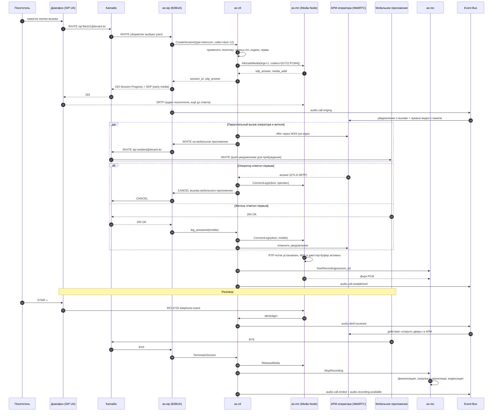

**Ключевые моменты.** Early media через 183 даёт оператору возможность слышать посетителя ещё до ответа — ценно для оценки ситуации. Параллельный вызов оператора и жителя с автоматической отменой «проигравшего» требует аккуратной обработки гонки: `as-ctl` ДОЛЖЕН атомарно фиксировать первого ответившего (компareAndSwap в Redis), иначе возможен двойной ответ.

**FR-15.** Политика «кто вызывается первым — оператор или житель, последовательно или параллельно» ДОЛЖНА быть настраиваемой на уровне тенанта и объекта. `[OPEN-10]` — требуется продуктовое решение о дефолте.

## 8.3. UC-02. Talk-back оператора в камеру

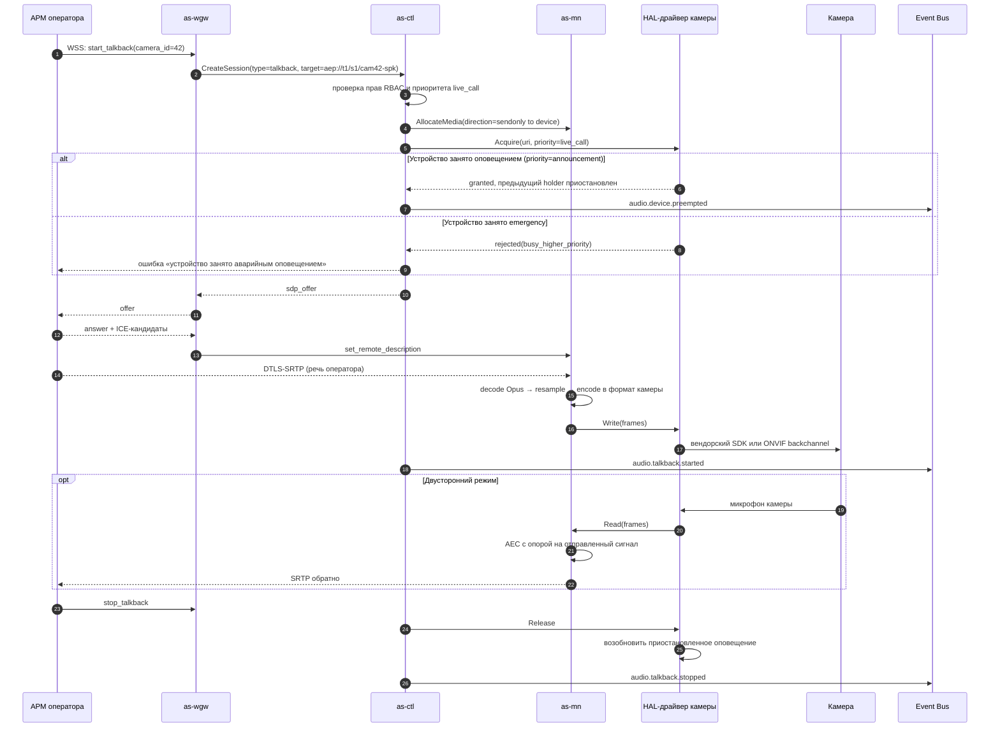

**Почему AEC критичен именно здесь.** Громкоговоритель и микрофон камеры находятся в одном корпусе: без эхоподавления оператор услышит собственный голос с задержкой. Если камера не даёт аппаратный AEC и CPU не хватает на программный, система обязана автоматически перейти в half-duplex и сообщить об этом в UI — молчаливая деградация качества недопустима.

## 8.4. UC-03. Групповая аудиоконференция

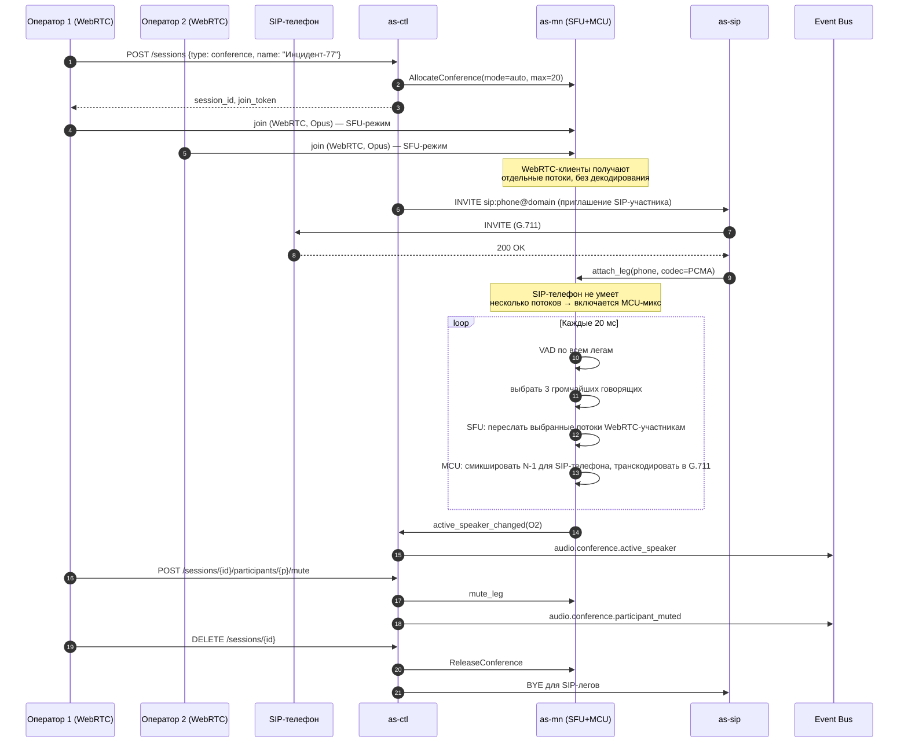

**Гибридный режим — ключевое решение.** Конференция не обязана быть целиком SFU или целиком MCU. Узел решает по каждому участнику: если клиент умеет принимать несколько потоков (WebRTC) — SFU; если нет (SIP-телефон, домофон, аналоговый громкоговоритель) — для него создаётся персональный N-1 микс. Это даёт и дешевизну SFU, и универсальность MCU.

`[ASSUMPTION]` Предел в 20 участников для одной конференции выбран исходя из операторских сценариев. Для массового оповещения (сотни слушателей) применяется UC-06 с односторонней рассылкой, а не конференция.

## 8.5. UC-04. PTT / half-duplex

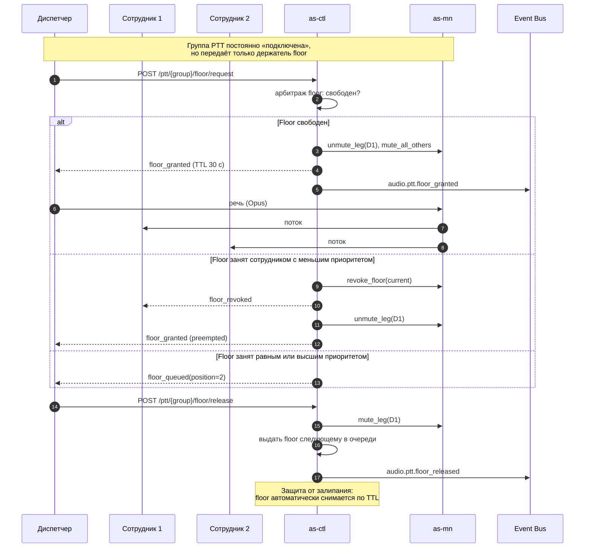

**FR-16.** Floor-контроль ДОЛЖЕН иметь TTL с автоматическим освобождением. Залипшая кнопка на одном терминале не должна блокировать всю группу.
**FR-17.** Задержка от нажатия кнопки до готовности передачи (floor grant) НЕ ДОЛЖНА превышать 300 мс в локальной сети. `[ASSUMPTION]` Значение взято по аналогии с отраслевыми требованиями к PTT в профессиональной радиосвязи.

## 8.6. UC-05. Аудиомониторинг и запись

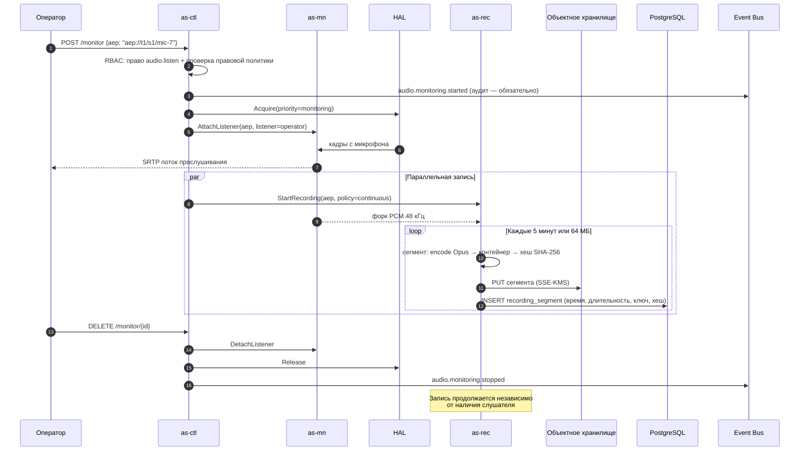

**FR-18.** Прослушивание ДОЛЖНО фиксироваться в неизменяемом журнале аудита: кто, какое устройство, когда, сколько по времени. Это требование закона и внутренней безопасности, а не опция.
**FR-19.** Запись НЕ ДОЛЖНА зависеть от наличия слушателя. Отвал Recorder'а НЕ ДОЛЖЕН приводить к разрыву разговора — только к событию о потере записи.

## 8.7. UC-06. Голосовое оповещение зоны

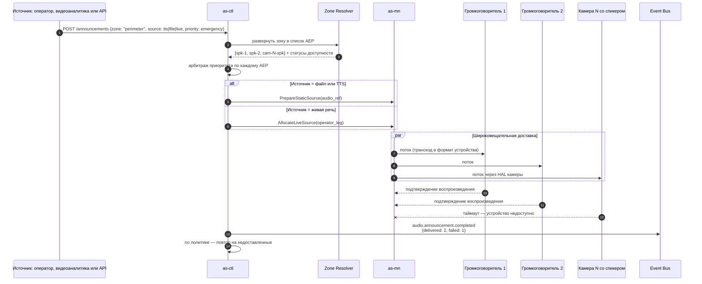

**FR-20.** Результат оповещения ДОЛЖЕН быть адресным: по каждому AEP фиксируется «доставлено / не доставлено / частично». Для аварийных оповещений это критично — диспетчер обязан знать, какая зона осталась без звука.

## 8.8. UC-07. Аудиоаналитика и корреляция с видео

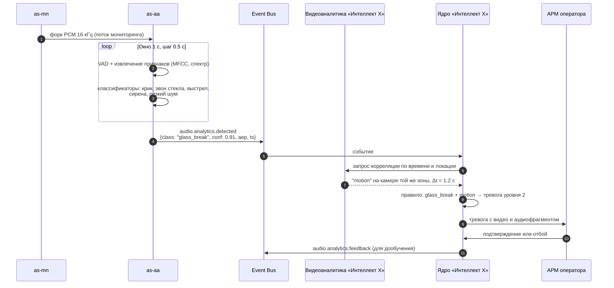

`[ASSUMPTION]` Предполагается, что базовый набор детекторов — крик/повышенный голос, звон стекла, выстрел, сирена, аномально громкий звук, и что для них приемлемо использование готовых моделей (например, на базе YAMNet/AudioSet) с дообучением на данных заказчика. Качество детекторов — отдельный R&D-трек, в оценку трудозатрат заложена только интеграционная обвязка. `[OPEN-12]`

## 8.9. UC-08. Hot-plug устройства во время разговора

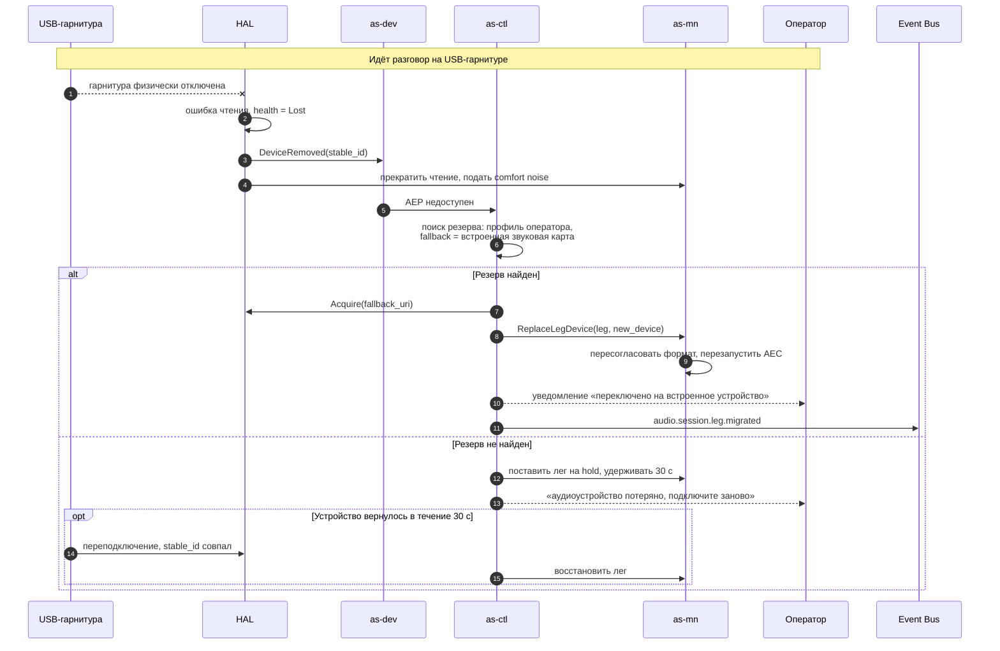

**FR-21.** Переключение устройства внутри активного лега НЕ ДОЛЖНО приводить к разрыву SIP-диалога или WebRTC-соединения. Меняется только привязка лега к HAL-устройству.

---

# 9. API-контракты

**Резюме.** Три контракта: REST для управления и интеграции внешних систем, gRPC для внутренних low-latency вызовов и стриминга, события в шине для асинхронного взаимодействия. Все три версионируются независимо, но описывают одну доменную модель.

## 9.1. Общие соглашения

| Аспект | Решение |
|---|---|
| Версионирование REST | Префикс пути: `/api/v1/...`; ломающие изменения — только новая мажорная версия |
| Версионирование gRPC | Пакет `itv.audio.v1`; новые поля только аддитивно |
| Аутентификация | OAuth 2.0 / OIDC, Bearer JWT; сервис-сервис — mTLS + SPIFFE ID |
| Тенант | Из claim `tenant_id` в токене; передача тенанта в теле запроса запрещена (защита от подмены) |
| Идемпотентность | Заголовок `Idempotency-Key` для всех POST, создающих сессии |
| Пагинация | Курсорная: `?cursor=...&limit=...` |
| Формат ошибок | RFC 7807 Problem Details |
| Трассировка | W3C Trace Context (`traceparent`); SIP Call-ID кладётся в атрибут спана |
| Rate limiting | Per-tenant и per-token; `429` + `Retry-After` |

## 9.2. REST API (OpenAPI 3.1, сокращённо)

### 9.2.1. Устройства и эндпоинты

```http
GET  /api/v1/devices?site_id=&kind=&status=&cursor=
GET  /api/v1/devices/{device_id}
PATCH /api/v1/devices/{device_id}         # зона, профиль, display_name
POST /api/v1/devices/{device_id}/test     # тестовый тон, проверка тракта
GET  /api/v1/endpoints?zone=&capability=
GET  /api/v1/endpoints/{aep_id}/health
```

```json
// GET /api/v1/devices/usb-7f3a → 200 OK
{
  "device_id": "usb-7f3a",
  "stable_id": "usb:0d8c:0014:SN12345",
  "uri": "hal://usb-uac/card2",
  "display_name": "Пост охраны — гарнитура",
  "kind": "duplex",
  "transport": "local",
  "status": "online",
  "site_id": "site-msk-01",
  "zone_ids": ["zone-lobby"],
  "capabilities": {
    "formats": [
      {"sample_rate_hz": 48000, "channels": 1, "format": "S16LE", "frame_ms": 20}
    ],
    "supports_hw_aec": false,
    "supports_duplex": true,
    "min_latency_ms": 20
  },
  "profile": {
    "codec_preference": ["opus", "g722", "pcma"],
    "dsp": {"aec": true, "ns": "moderate", "agc": true},
    "priority_class": "live_call"
  },
  "metrics": {"level_dbfs": -22.4, "xruns_1h": 0}
}
```

### 9.2.2. Сессии

```http
POST   /api/v1/sessions
GET    /api/v1/sessions?status=&type=&cursor=
GET    /api/v1/sessions/{session_id}
DELETE /api/v1/sessions/{session_id}
POST   /api/v1/sessions/{session_id}/participants
DELETE /api/v1/sessions/{session_id}/participants/{participant_id}
PATCH  /api/v1/sessions/{session_id}/participants/{participant_id}   # mute, gain, direction
POST   /api/v1/sessions/{session_id}/hold
POST   /api/v1/sessions/{session_id}/transfer
POST   /api/v1/sessions/{session_id}/dtmf
POST   /api/v1/sessions/{session_id}/recording:start
POST   /api/v1/sessions/{session_id}/recording:stop
```

```json
// POST /api/v1/sessions
{
  "type": "point_to_point",          // point_to_point | conference | ptt | announcement | monitor
  "participants": [
    {"aep": "aep://t1/site-msk-01/door-12", "direction": "sendrecv"},
    {"aep": "sip:operator-5@tenant.itv",    "direction": "sendrecv"}
  ],
  "policy": {
    "record": true,
    "codec_preference": ["opus", "g722", "pcma"],
    "max_duration_sec": 3600,
    "priority_class": "live_call",
    "dtmf": "rfc4733"
  },
  "metadata": {"incident_id": "INC-2026-0042", "operator_id": "op-5"}
}
```

```json
// 201 Created
{
  "session_id": "ses_01JBX8K2",
  "state": "connecting",
  "media_node": "mn-eu-03",
  "participants": [
    {"participant_id": "p_1", "aep": "aep://t1/site-msk-01/door-12",
     "state": "ringing", "direction": "sendrecv"},
    {"participant_id": "p_2", "aep": "sip:operator-5@tenant.itv",
     "state": "ringing", "direction": "sendrecv"}
  ],
  "recording": {"enabled": true, "recording_id": "rec_01JBX8K3"},
  "created_at": "2026-10-05T11:20:31Z"
}
```

### 9.2.3. Зоны, оповещения, PTT

```http
POST /api/v1/zones
GET  /api/v1/zones/{zone_id}/members
POST /api/v1/announcements
GET  /api/v1/announcements/{id}          # статус доставки по каждому AEP
POST /api/v1/ptt/groups
POST /api/v1/ptt/groups/{group_id}/floor:request
POST /api/v1/ptt/groups/{group_id}/floor:release
```

```json
// POST /api/v1/announcements
{
  "targets": {"zones": ["perimeter"], "endpoints": ["aep://t1/site-msk-01/spk-3"]},
  "source": {"type": "tts", "text": "Внимание. Эвакуация через главный выход.",
             "voice": "ru-RU-female-1"},
  "priority_class": "emergency",
  "repeat": {"count": 3, "interval_sec": 10}
}
```

### 9.2.4. Записи

```http
GET  /api/v1/recordings?from=&to=&aep=&session_id=&participant=&cursor=
GET  /api/v1/recordings/{recording_id}
GET  /api/v1/recordings/{recording_id}/segments
POST /api/v1/recordings/{recording_id}/export     # → подписанная ссылка
GET  /api/v1/recordings/{recording_id}/waveform   # пиковая огибающая для UI
POST /api/v1/recordings/{recording_id}/legal-hold
DELETE /api/v1/recordings/{recording_id}          # с проверкой retention и legal hold
```

### 9.2.5. Конфигурация Kamailio (управляемая)

```http
GET  /api/v1/sip/config                   # текущая эффективная конфигурация
GET  /api/v1/sip/config/revisions
POST /api/v1/sip/config:validate          # dry-run проверка шаблона
POST /api/v1/sip/config:apply             # применение с автоматическим снапшотом
POST /api/v1/sip/config:rollback
GET  /api/v1/sip/registrations?aep=       # зеркало location service
GET  /api/v1/sip/trunks
```

## 9.3. gRPC API (внутренний)

```protobuf
syntax = "proto3";
package itv.audio.v1;
import "google/protobuf/timestamp.proto";

// ---------- Media Node: вызывается Session Controller ----------
service MediaNode {
  rpc AllocateSession (AllocateSessionRequest) returns (AllocateSessionResponse);
  rpc AddLeg          (AddLegRequest)          returns (AddLegResponse);
  rpc ModifyLeg       (ModifyLegRequest)       returns (ModifyLegResponse);
  rpc RemoveLeg       (RemoveLegRequest)       returns (Empty);
  rpc ReleaseSession  (ReleaseSessionRequest)  returns (Empty);

  // Серверный стрим: телеметрия качества в реальном времени
  rpc StreamQoE       (QoERequest)             returns (stream QoESample);
  // Двунаправленный стрим: сырое аудио для аналитики и записи
  rpc StreamAudio     (stream AudioChunk)      returns (stream AudioChunk);
  rpc Health          (Empty)                  returns (NodeHealth);
}

message AllocateSessionRequest {
  string tenant_id   = 1;
  string session_id  = 2;
  SessionType type   = 3;
  MediaPolicy policy = 4;
  uint32 expected_legs = 5;
}

message AddLegRequest {
  string session_id = 1;
  string leg_id     = 2;
  oneof endpoint {
    SdpOffer    sdp       = 3;   // SIP или WebRTC
    HalDeviceRef device    = 4;  // локальное устройство через HAL
    RtspSource  rtsp       = 5;  // аудиодорожка из RTSP
  }
  Direction direction = 6;        // SENDONLY | RECVONLY | SENDRECV | INACTIVE
  repeated CodecSpec codecs = 7;
  DspConfig dsp = 8;
}

message QoESample {
  string leg_id = 1;
  google.protobuf.Timestamp ts = 2;
  uint32 jitter_ms          = 3;
  float  packet_loss_pct    = 4;
  uint32 rtt_ms             = 5;
  float  mos_estimate       = 6;   // E-model, ITU-T G.107
  uint32 jitter_buffer_ms   = 7;
  uint32 concealed_samples  = 8;
  float  input_level_dbfs   = 9;
  bool   transcoding_active = 10;
}

message NodeHealth {
  enum State { OK = 0; DEGRADED = 1; DRAINING = 2; UNHEALTHY = 3; }
  State  state            = 1;
  uint32 active_sessions  = 2;
  uint32 active_legs      = 3;
  float  cpu_pct          = 4;
  float  net_mbps         = 5;
  uint32 capacity_legs    = 6;   // для placement-решения в as-ctl
}

// ---------- HAL: единый контракт и для встраивания, и по сети ----------
service AudioDevice {
  rpc ListDevices     (ListDevicesRequest)  returns (ListDevicesResponse);
  rpc OpenStream      (OpenStreamRequest)   returns (stream AudioFrame);
  rpc WriteStream     (stream AudioFrame)   returns (WriteStreamResponse);
  rpc SubscribeEvents (Empty)               returns (stream DeviceEvent);
  rpc SetGain         (SetGainRequest)      returns (Empty);
}

message AudioFrame {
  bytes  payload       = 1;
  uint32 sample_rate   = 2;
  uint32 channels      = 3;
  string encoding      = 4;    // "s16le" | "opus" | "pcma"
  uint64 pts_ns        = 5;
  uint64 ntp_timestamp = 6;    // синхронизация с видео
  bool   silence       = 7;
}
```

**Почему одновременно REST и gRPC.** REST — внешний контракт: его потребляют АРМ, мобильное приложение, партнёры и скрипты, для него важны читаемость и инструменты. gRPC — внутренний: `as-ctl → as-mn` вызывается на каждом установлении лега, и здесь важны бинарная сериализация, стриминг телеметрии и двунаправленные потоки аудио. Попытка обойтись только REST привела бы к тому, что телеметрия QoE и форк аудио в аналитику пришлось бы строить на костылях.

## 9.4. События в шине сообщений

**Транспорт `[ASSUMPTION]`:** NATS JetStream как основной (низкая задержка, простая эксплуатация, встроенная персистентность), с адаптером к Kafka для заказчиков, у которых Kafka уже стандарт. Финальное решение — `[OPEN-05]`.

**Схема субъектов:** `itv.audio.<tenant_id>.<domain>.<event>`
Пример: `itv.audio.t1.call.established`, `itv.audio.t1.analytics.detected`

**Формат:** CloudEvents 1.0, payload — JSON (Protobuf как опция для высокочастотных событий).

| Домен | Событие | Назначение | Частота `[ASSUMPTION]` |
|---|---|---|---|
| `device` | `arrived`, `removed`, `state_changed`, `preempted` | Жизненный цикл устройств | Низкая |
| `endpoint` | `available`, `unavailable`, `registered` | Доступность AEP | Низкая |
| `call` | `ringing`, `established`, `ended`, `failed`, `held`, `transferred` | Жизненный цикл разговора | Средняя |
| `session` | `created`, `leg_added`, `leg_removed`, `leg_migrated`, `terminated` | Детальная телеметрия сессии | Средняя |
| `conference` | `started`, `participant_joined`, `participant_left`, `active_speaker`, `ended` | Конференции | Средняя |
| `ptt` | `floor_granted`, `floor_released`, `floor_revoked`, `floor_queued` | PTT | Высокая в активной группе |
| `recording` | `started`, `segment_written`, `stopped`, `available`, `failed` | Запись | Средняя |
| `analytics` | `detected`, `vad_changed`, `feedback` | Аудиоаналитика | Высокая |
| `dtmf` | `received` | Коды, открытие дверей | Низкая |
| `quality` | `degraded`, `restored` | Деградация качества связи | Низкая |
| `announcement` | `started`, `delivered`, `failed`, `completed` | Оповещения | Низкая |
| `security` | `auth_failed`, `fraud_suspected`, `policy_violation` | ИБ | Низкая |

```json
{
  "specversion": "1.0",
  "type": "itv.audio.call.established",
  "source": "/itv-as/as-ctl/mn-eu-03",
  "id": "evt_01JBX8K9",
  "time": "2026-10-05T11:20:35.412Z",
  "subject": "ses_01JBX8K2",
  "datacontenttype": "application/json",
  "traceparent": "00-4bf92f3577b34da6a3ce929d0e0e4736-00f067aa0ba902b7-01",
  "data": {
    "tenant_id": "t1",
    "session_id": "ses_01JBX8K2",
    "session_type": "intercom",
    "participants": [
      {"participant_id": "p_1", "aep": "aep://t1/site-msk-01/door-12",
       "codec": "G722", "transport": "srtp"},
      {"participant_id": "p_2", "aep": "sip:operator-5@tenant.itv",
       "codec": "opus", "transport": "dtls-srtp"}
    ],
    "transcoding": true,
    "setup_time_ms": 1340,
    "recording_id": "rec_01JBX8K3",
    "media_node": "mn-eu-03"
  }
}
```

**Гарантии доставки.** At-least-once для всех событий; потребители обязаны быть идемпотентными по `id`. Порядок гарантируется в пределах одного `session_id` (партиционирование по ключу). События `security.*` и `recording.*` публикуются с персистентностью и подтверждением; `analytics.vad_changed` — best-effort, допустима потеря.

---

# 10. Модель данных и хранение записей

**Резюме.** Метаданные — в PostgreSQL с изоляцией по тенанту на уровне строк; медиаданные — в объектном хранилище посегментно; горячие оперативные состояния (регистрации, floor, блокировки) — в Redis с TTL. Запись никогда не пишется одним большим файлом: сегментация даёт устойчивость к сбоям и возможность начать отдавать запись до завершения разговора.

## 10.1. Логическая модель

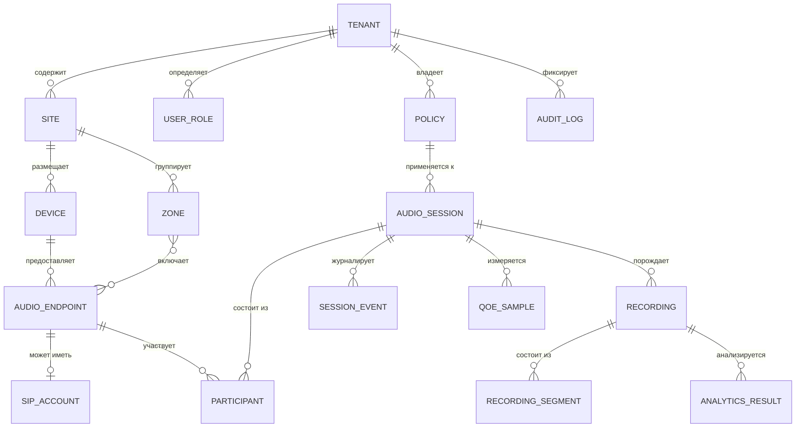

## 10.2. Основные таблицы

### `audio_endpoint`

| Поле | Тип | Описание |
|---|---|---|
| `aep_id` | `uuid` PK | Идентификатор |
| `tenant_id` | `uuid` | Тенант, RLS-ключ |
| `site_id` | `uuid` | Объект |
| `device_id` | `uuid` FK | Физическое устройство (NULL для чисто логических, например SIP-аккаунта) |
| `uri` | `text` UNIQUE | `aep://tenant/site/name` |
| `kind` | `enum` | `capture` / `render` / `duplex` |
| `transport` | `enum` | `local` / `sip` / `webrtc` / `rtsp` / `multicast` |
| `capabilities` | `jsonb` | Нормализованные возможности |
| `profile` | `jsonb` | Кодеки, DSP, приоритет |
| `zone_ids` | `uuid[]` | Членство в зонах |
| `status` | `enum` | `online` / `offline` / `degraded` / `unprovisioned` |
| `last_seen_at` | `timestamptz` | |

### `audio_session`

| Поле | Тип | Описание |
|---|---|---|
| `session_id` | `uuid` PK | |
| `tenant_id` | `uuid` | RLS |
| `type` | `enum` | `point_to_point` / `conference` / `ptt` / `announcement` / `monitor` / `intercom` |
| `state` | `enum` | `creating` / `connecting` / `active` / `held` / `terminating` / `ended` / `failed` |
| `media_node_id` | `text` | Узел, обслуживающий сессию |
| `policy` | `jsonb` | Применённая политика |
| `started_at`, `answered_at`, `ended_at` | `timestamptz` | Для расчёта setup time и длительности |
| `end_reason` | `text` | `normal` / `timeout` / `preempted` / `error:<code>` |
| `metadata` | `jsonb` | Внешние связки: incident_id, operator_id |
| `correlation_id` | `text` | SIP Call-ID или W3C trace id |

Партиционирование по месяцу `started_at`.

### `recording` и `recording_segment`

| `recording` | Тип | Описание |
|---|---|---|
| `recording_id` | `uuid` PK | |
| `tenant_id`, `session_id` | `uuid` | |
| `aep_ids` | `uuid[]` | Чьё аудио записано |
| `mode` | `enum` | `mixed` (общий файл) / `per_leg` (раздельно по участникам) |
| `codec`, `container` | `text` | `opus` / `aac` / `pcm`; `ogg` / `mka` / `mp4` |
| `started_at`, `ended_at`, `duration_ms` | | |
| `total_bytes` | `bigint` | |
| `retention_until` | `timestamptz` | Из политики |
| `legal_hold` | `bool` | Блокирует удаление независимо от retention |
| `encryption_key_id` | `text` | Ссылка на ключ в KMS |
| `integrity_hash` | `bytea` | Хеш манифеста сегментов |
| `state` | `enum` | `recording` / `finalizing` / `available` / `failed` / `deleted` |

| `recording_segment` | Тип | Описание |
|---|---|---|
| `segment_id` | `uuid` PK | |
| `recording_id` | `uuid` FK | |
| `seq` | `int` | Порядковый номер |
| `object_key` | `text` | Ключ в объектном хранилище |
| `started_at`, `duration_ms` | | |
| `bytes`, `sha256` | | Целостность каждого сегмента отдельно |

**Почему посегментно.** Сбой узла в середине часового разговора при монолитном файле означает потерю всего. При сегментации по 5 минут теряется максимум последний сегмент, а уже выгруженные доступны сразу — в том числе для прослушивания идущего разговора «с отставанием».

### `qoe_sample`

Хранится в time-series: TimescaleDB-гипертаблица или отдельный Prometheus/VictoriaMetrics. `[OPEN-13]` Поля: `session_id`, `leg_id`, `ts`, `jitter_ms`, `loss_pct`, `rtt_ms`, `mos`, `jb_ms`, `concealed_ms`. Агрегаты за разговор дублируются в `audio_session.quality_summary` (jsonb) — чтобы построить отчёт без обращения к TSDB.

## 10.3. Схема хранения в объектном хранилище

```
s3://itv-audio-recordings/
  {tenant_id}/
    {yyyy}/{mm}/{dd}/
      {recording_id}/
        manifest.json                 # список сегментов, хеши, кодек, участники
        seg-000001.opus.ogg
        seg-000002.opus.ogg
        ...
        waveform.json                 # пиковая огибающая для UI
        transcript.json               # опционально, если включён ASR
```

| Аспект | Решение |
|---|---|
| Шифрование | SSE-KMS, ключ на тенант; ротация ключей не требует перешифрования (envelope encryption) |
| Жизненный цикл | Горячий слой 30 дней → холодный/архивный по политике тенанта |
| Неизменяемость | Object Lock (WORM) для записей с `legal_hold` или по требованию регламента |
| Целостность | SHA-256 на сегмент + хеш манифеста; верификация при экспорте |
| Доступ | Только через API с подписанными ссылками ограниченного TTL; прямой доступ к бакету закрыт |

`[ASSUMPTION]` Основной формат записи — **Opus в контейнере Ogg**: свободен от лицензионных ограничений, компактен (речь ~16–24 кбит/с), нативен для WebRTC, хорошо переживает потери. AAC предусмотрен для случаев, когда запись должна лежать в одном контейнере с видео в архиве «Интеллект X». Окончательный выбор зависит от требований архива — `[OPEN-09]`.

## 10.4. Оценка объёмов

`[ASSUMPTION]` Расчёт для Opus 24 кбит/с (речь, моно, 16 кГц) — ориентир для планирования, подлежит уточнению по реальному профилю нагрузки заказчика.

| Сценарий | Аудио/час на поток | 100 потоков × 8 ч/сут | В месяц (30 дней) | В год |
|---|---|---|---|---|
| Запись разговоров (по требованию) | ~11 МБ | ~8,6 ГБ/сут | ~258 ГБ | ~3,1 ТБ |
| Непрерывная запись микрофонов 24/7 | ~11 МБ | ~26 ГБ/сут (100 × 24 ч) | ~790 ГБ | ~9,5 ТБ |
| Метаданные (сессии, QoE, события) | — | ~50 МБ/сут | ~1,5 ГБ | ~18 ГБ |

При выборе L16 без потерь объём вырастает примерно в 40 раз — этот режим применим только точечно (экспертиза, суд).

## 10.5. Retention и соответствие требованиям

| Политика | Значение по умолчанию `[ASSUMPTION]` | Настраивается |
|---|---|---|
| Разговоры домофонии | 30 дней | на тенант |
| Разговоры операторов | 90 дней | на тенант |
| Записи с тревожными событиями | 365 дней | на тип события |
| Legal hold | бессрочно до снятия | вручную, с аудитом |
| Метаданные сессий | 2 года | на тенант |
| Аудит-лог | 3 года, неизменяемый | фиксировано |

**FR-22.** Удаление записи по истечении retention ДОЛЖНО быть безвозвратным, логироваться в аудите и блокироваться при активном legal hold.
**FR-23.** ДОЛЖЕН поддерживаться экспорт всех записей, относящихся к конкретному субъекту персональных данных, и их удаление по обоснованному запросу (ФЗ-152/GDPR).

---

# 11. Безопасность

**Резюме.** Модель безопасности строится на трёх уровнях: защищённый транспорт везде по умолчанию, строгая аутентификация и авторизация на каждом вызове, полный аудит всего, что касается прослушивания и записи голоса. Голос — персональные данные, поэтому требования к аудиоподсистеме строже, чем к служебным сервисам платформы.

## 11.1. Модель угроз (сокращённо, STRIDE)

| Угроза | Вектор | Контрмера |
|---|---|---|
| **S** Подмена абонента | Регистрация чужого SIP-аккаунта | Digest + TLS, привязка к IP/сертификату для устройств, детекция смены локации |
| **S** Подмена сервера | Фальшивый прокси | Проверка сертификата на клиентах, SIP Identity `[OPEN]` для транков |
| **T** Подмена медиа | Инъекция RTP в активную сессию | SRTP обязателен; проверка SSRC; строгая проверка источника (latching с валидацией) |
| **T** Подмена конфигурации | Правка kamailio.cfg в обход системы | Управляемые шаблоны, контроль целостности, алерт на расхождение |
| **R** Отрицание прослушивания | «Я не слушал этот микрофон» | Неизменяемый аудит-лог прослушиваний с подписью |
| **I** Перехват разговора | Сниффинг в сети объекта | TLS 1.3 для сигнализации, SRTP-GCM для медиа, запрет plain RTP по умолчанию |
| **I** Утечка записей | Доступ к бакету | SSE-KMS, подписанные ссылки, запрет прямого доступа, сетевая изоляция |
| **D** Отказ в обслуживании | SIP-флуд, ICE-амплификация | Rate limit в Kamailio (`pike`, `htable`), SYN cookies, лимит на тенант, защита TURN |
| **D** Исчерпание медиа-ёмкости | Массовое создание сессий | Квоты на тенант, admission control на Media Node |
| **E** Эскалация прав | Доступ к чужому тенанту | RLS в БД, `tenant_id` только из токена, mTLS между сервисами |
| **E** Toll fraud | Звонки на премиум-номера через транк | Allow-list направлений, лимиты стоимости/длительности, аномалии по частоте |

## 11.2. Транспорт и криптография

| Канал | Протокол | Шифры |
|---|---|---|
| Клиент → API | HTTPS, TLS 1.3 (минимум 1.2) | TLS_AES_256_GCM_SHA384, ECDHE |
| SIP-сигнализация | SIP/TLS 5061 | Сертификаты от внутреннего CA или публичного |
| SIP-медиа | SRTP | AES-128-GCM (предпочтительно), AES-CM-128-HMAC-SHA1-80 (fallback) |
| WebRTC | DTLS-SRTP | Обязателен, согласование через `a=fingerprint` |
| Сервис → сервис | mTLS | SPIFFE/SPIRE-идентичности, автоматическая ротация |
| Шина событий | TLS + аутентификация | NATS NKey/JWT или Kafka SASL_SSL |
| БД | TLS | Обязательно |
| Хранилище | TLS + SSE-KMS | Шифрование at-rest |

**NFR-30.** Доля сессий с незашифрованным медиа ДОЛЖНА экспортироваться метрикой и отображаться на дашборде безопасности. Цель — 0 % вне явного legacy allow-list.

## 11.3. Аутентификация и авторизация

```mermaid
flowchart LR
    U["Пользователь / сервис"] --> IDP["ITV Cloud Identity<br/>OIDC"]
    IDP -->|"JWT: sub, tenant_id, roles, scopes"| GW["API Gateway"]
    GW -->|"валидация подписи, aud, exp"| CTL["as-ctl"]
    CTL --> RBAC["RBAC Engine"]
    RBAC --> OBJ["Проверка на объекте:<br/>tenant → site → zone → aep"]
    OBJ --> DEC{"Разрешено?"}
    DEC -->|да| ACT["Выполнить"]
    DEC -->|нет| DENY["403 + audit.policy_violation"]
```

### Ролевая модель

| Роль | Права |
|---|---|
| `audio.viewer` | Просмотр устройств, сессий и метаданных записей; без доступа к звуку |
| `audio.listener` | + прослушивание в реальном времени, воспроизведение записей |
| `audio.operator` | + инициация разговоров, talk-back, участие в конференциях |
| `audio.dispatcher` | + оповещения, PTT floor с повышенным приоритетом, управление конференцией |
| `audio.recorder_admin` | + экспорт записей, управление retention, снятие legal hold |
| `audio.admin` | + конфигурация устройств, зон, политик, SIP-транков |
| `audio.security_auditor` | Чтение аудит-лога; **без** права слушать записи (разделение обязанностей) |

**FR-24.** Права проверяются на уровне объекта, а не только эндпоинта: наличие роли `audio.listener` не даёт доступа ко всем микрофонам, а только к тем сайтам/зонам, которые назначены пользователю.
**FR-25.** Роль `audio.security_auditor` принципиально НЕ ДОЛЖНА включать доступ к содержимому записей — иначе аудит перестаёт быть независимым контролем.

## 11.4. Аудит

Отдельное неизменяемое хранилище (append-only таблица с запретом UPDATE/DELETE на уровне прав БД + периодическая выгрузка с подписью).

| Событие | Фиксируется |
|---|---|
| Прослушивание AEP | кто, что, когда, сколько, с какого IP, по какому обоснованию |
| Воспроизведение/экспорт записи | кто, какая запись, целиком или фрагмент, куда выгружено |
| Изменение политики записи | старое и новое значение, автор |
| Изменение конфигурации Kamailio | diff, автор, результат применения |
| Снятие legal hold, удаление записи | кто, обоснование |
| Отказ в доступе | кто, к чему, причина |
| Изменение прав | кто кому что выдал |

## 11.5. Приватность и правовые аспекты

- **FR-26.** Для AEP с непрерывной записью ДОЛЖНА поддерживаться индикация записи (светодиод, периодический тональный сигнал, табличка) — конфигурируемо под требования юрисдикции.
- **FR-27.** ДОЛЖНА поддерживаться настройка «зон молчания» — AEP, запись с которых запрещена политикой (например, комнаты отдыха, медпункт).
- **FR-28.** Экспорт записей ДОЛЖЕН сопровождаться водяным знаком метаданных (кто, когда выгрузил) в манифесте.

`[OPEN-08]` Требуется заключение юристов по перечню юрисдикций, где нужна явная индикация записи и согласие сторон, и по допустимости непрерывной записи аудио в публичных зонах.

---

# 12. Нефункциональные требования и метрики

**Резюме.** Раздел задаёт числовые цели, по которым система принимается и эксплуатируется. Для каждого требования указан способ измерения — требование без метода проверки нереализуемо.

## 12.1. Задержка и качество

| # | Требование | Цель | Макс. допустимо | Метод измерения |
|---|---|---|---|---|
| NFR-01 | Mouth-to-ear, LAN, без транскодирования | ≤ 100 мс | 150 мс | Аппаратный loopback-тест с генератором и анализатором |
| NFR-02 | Mouth-to-ear, через облако (один регион) | ≤ 180 мс | 250 мс | Синтетический зонд, p95 за сутки |
| NFR-03 | Mouth-to-ear с транскодированием | +25 мс к базе | +40 мс | Сравнительный тест |
| NFR-04 | Задержка конференции MCU | ≤ 220 мс | 300 мс | p95 |
| NFR-05 | MOS (Opus, потери < 1 %) | ≥ 4.2 | 4.0 | E-model G.107 + периодический POLQA |
| NFR-06 | MOS (G.711, потери 1 %) | ≥ 3.8 | 3.6 | То же |
| NFR-07 | Устойчивость к потерям | Без заметной деградации до 5 % | До 20 % разборчиво | Сетевой эмулятор (netem) |
| NFR-08 | Джиттер-буфер | Адаптивный 20–200 мс | 300 мс пик | Метрика `jitter_buffer_ms` |
| NFR-09 | Время установления вызова (домофон) | ≤ 1.5 с | 2 с | От INVITE до 200 OK, p95 |
| NFR-10 | Время установления WebRTC-сессии | ≤ 1 с | 2 с | От offer до первого медиапакета |
| NFR-11 | PTT floor grant | ≤ 200 мс | 300 мс | От запроса до разрешения, p95 |
| NFR-12 | Рассинхронизация аудио/видео | ≤ 40 мс | 80 мс (ITU-R BT.1359) | RTCP SR + тест с хлопушкой |

## 12.2. Ёмкость и производительность

`[ASSUMPTION]` Значения — целевые ориентиры для планирования, подлежащие уточнению по результатам нагрузочного тестирования на референсном железе. Базовая конфигурация Media Node: 4 vCPU (x86-64, AVX2), 8 ГБ RAM, 1 Гбит/с.

| # | Требование | Значение на узел |
|---|---|---|
| NFR-13 | Релейные сессии SRTP без транскодирования | 500 одновременных легов |
| NFR-14 | Сессии с транскодированием Opus ↔ G.711 | 150 легов |
| NFR-15 | Легов в MCU-конференциях (с микшированием) | 50 легов |
| NFR-16 | Легов с полным DSP (AEC + NS + AGC) | 80 легов |
| NFR-17 | Запись (форк + кодирование Opus) | 300 потоков |
| NFR-18 | Пропускная способность на узел | 200 Мбит/с устойчиво |
| NFR-19 | Горизонтальное масштабирование | Линейное до 50 узлов на кластер |
| NFR-20 | Профиль `embedded` | 2 полнодуплексных сессии, ≤ 15 % CPU ARMv8 @1 ГГц, ≤ 64 МБ RAM |
| NFR-21 | Профиль `standalone` | 200 легов на 8 vCPU / 16 ГБ |
| NFR-22 | Control plane | 2000 RPS на инстанс, p99 < 100 мс |
| NFR-23 | Холодный старт Media Node | ≤ 10 с до готовности принимать сессии |

**Расчёт полосы на лег** (для планирования сети):

| Кодек | Payload | С учётом RTP/UDP/IP | С SRTP | Два направления |
|---|---|---|---|---|
| Opus 24 кбит/с, 20 мс | 24 | ~40 кбит/с | ~42 кбит/с | ~84 кбит/с |
| G.722 64 кбит/с | 64 | ~80 кбит/с | ~82 кбит/с | ~164 кбит/с |
| G.711 64 кбит/с | 64 | ~80 кбит/с | ~82 кбит/с | ~164 кбит/с |

500 легов G.711 в обе стороны ≈ 82 Мбит/с — укладывается в NFR-18 с запасом, но на 1 Гбит/с интерфейсе ограничением станет не полоса, а pps: 500 легов × 50 пакетов/с × 2 = 50 000 pps. Это требует настройки сетевого стека (RSS, увеличенные кольцевые буферы) и подтверждает решение о `hostNetwork` для медиа-подов.

## 12.3. Надёжность

| # | Требование | Значение |
|---|---|---|
| NFR-24 | SLA профиля `cloud` | 99.9 % доступности control plane (≈ 43 мин/мес) |
| NFR-25 | SLA медиа-плоскости | 99.95 % успешных установлений вызова |
| NFR-26 | SLA профиля `standalone` | 99.5 % (одиночный узел) |
| NFR-27 | Сохранность активных сессий при обновлении | 100 % (drain-and-replace) |
| NFR-28 | Потеря записей | ≤ 0.01 % сегментов; потеря последнего сегмента при аварии допустима |
| NFR-29 | RTO / RPO control plane | RTO 5 мин / RPO 1 мин |
| NFR-31 | Деградация при отказе облака | Профили `embedded` и `standalone` продолжают локальные сценарии ≥ 24 ч |
| NFR-32 | Восстановление после сетевого разрыва | Автоматическая переустановка регистраций ≤ 60 с |

## 12.4. Наблюдаемость

### Метрики (Prometheus)

| Метрика | Тип | Назначение |
|---|---|---|
| `itv_audio_sessions_active{tenant,type,node}` | gauge | Текущая загрузка |
| `itv_audio_session_setup_seconds{type}` | histogram | NFR-09, NFR-10 |
| `itv_audio_session_duration_seconds{type,end_reason}` | histogram | Профиль использования |
| `itv_audio_leg_mos{node,codec}` | gauge | NFR-05, NFR-06 |
| `itv_audio_leg_jitter_ms`, `_packet_loss_ratio`, `_rtt_ms` | gauge | Качество сети |
| `itv_audio_jitter_buffer_ms` | histogram | NFR-08 |
| `itv_audio_transcoding_active_ratio` | gauge | Индикатор неоптимальной конфигурации |
| `itv_audio_device_state{device,state}` | gauge | Здоровье устройств |
| `itv_audio_device_xruns_total` | counter | Проблемы с буферами |
| `itv_audio_sip_registrations{state}` | gauge | Связь с Kamailio |
| `itv_audio_sip_responses_total{code}` | counter | Доля 4xx/5xx |
| `itv_audio_recording_lag_seconds` | gauge | Отставание выгрузки сегментов |
| `itv_audio_recording_failed_total` | counter | NFR-28 |
| `itv_audio_node_capacity_ratio` | gauge | Основа для HPA |
| `itv_audio_insecure_media_sessions` | gauge | NFR-30 |
| `itv_audio_aec_fallback_total` | counter | Сколько раз пришлось уйти в half-duplex |

### Логи

Структурированный JSON, обязательные поля: `ts`, `level`, `service`, `tenant_id`, `session_id`, `leg_id`, `sip_call_id`, `trace_id`, `msg`. Уровни: ERROR — требует вмешательства; WARN — деградация; INFO — жизненный цикл сессий; DEBUG — только по флагу на конкретную сессию (критично: отладочное логирование всего медиа-тракта на продакшене недопустимо по объёму).

### Трассировка

OpenTelemetry. Спан на сессию, дочерние — на каждый лег, на SIP-транзакцию, на аллокацию медиа, на старт записи. `sip_call_id` и `session_id` — атрибуты спана, что позволяет перейти от жалобы «плохо слышно в 14:32» к полному пути вызова.

### Алерты (примеры)

| Условие | Серьёзность |
|---|---|
| `itv_audio_sip_registrations{state="failed"} > 0` 5 мин | critical |
| p95 `session_setup_seconds` > 2 с | warning |
| `leg_mos` < 3.5 для > 10 % легов | warning |
| `recording_lag_seconds` > 300 | critical |
| `node_capacity_ratio` > 0.8 | warning (автомасштабирование) |
| `insecure_media_sessions` > 0 вне allow-list | critical |

---

# 13. Масштабирование и отказоустойчивость

**Резюме.** Control plane масштабируется тривиально (stateless + общее состояние). Нетривиальная часть — медиа: сессия привязана к конкретному узлу на всё время разговора, поэтому масштабирование здесь — это правильный выбор узла при старте и аккуратный вывод узла из эксплуатации, а не перераспределение нагрузки на лету.

## 13.1. Стратегия масштабирования

| Слой | Модель | Триггер | Ограничение |
|---|---|---|---|
| API Gateway, `as-ctl`, `as-dev` | Горизонтально, stateless | CPU > 70 % или RPS | Пропускная способность PostgreSQL |
| `as-sip` | Горизонтально, пул за Kamailio dispatcher | Число диалогов | Реплика состояния диалогов в Redis |
| `as-mn` | Горизонтально, sticky по сессии | `node_capacity_ratio` > 0.7 | Сеть и CPU узла; сессия не мигрирует |
| `as-wgw` | Горизонтально | Число WS-соединений | — |
| `as-rec`, `as-aa` | Горизонтально, очередь задач | Лаг очереди | Пропускная способность хранилища |
| PostgreSQL | Вертикально + read-реплики | — | Запись не шардируется в v1 |
| NATS/Kafka | Кластер | — | — |

## 13.2. Выбор медиа-узла (placement)

```
FUNCTION select_media_node(session_request):
    candidates = nodes.filter(
        state == OK,
        tenant_allowed(node, session.tenant),
        region == session.preferred_region,
        capacity_ratio < 0.85
    )

    IF candidates IS EMPTY:
        candidates = nodes.filter(state == OK, capacity_ratio < 0.95)   // расширяем регион
    IF candidates IS EMPTY:
        trigger_scale_out()
        RETURN error(503, "no_capacity")

    // Сессия тяжелее, если нужны транскодинг, микширование, запись
    cost = estimate_cost(session_request)   // в условных «единицах лега»

    FOR node IN candidates:
        score = 0.45 * (1 - node.capacity_ratio)       // свободная ёмкость
              + 0.35 * rtt_score(node, session.participants)  // близость к устройствам
              + 0.15 * affinity_score(node, session.tenant)   // локальность тенанта
              + 0.05 * random()                                // антидетерминизм

    chosen = argmax(score)
    reserve(chosen, cost)        // резервирование до подтверждения
    RETURN chosen
```

**Ключевой нюанс.** Стоимость сессии неодинакова: релейный лег без транскодирования в 5–8 раз дешевле лега с AEC и микшированием. Планирование по числу сессий вместо «единиц стоимости» приведёт к перегрузке узлов, на которые случайно попали тяжёлые конференции.

## 13.3. Отказоустойчивость по компонентам

| Отказ | Влияние | Восстановление |
|---|---|---|
| Инстанс `as-ctl` | Нет; активные сессии не затронуты | LB убирает из пула; новые запросы на другие инстансы |
| Все `as-ctl` | Нельзя создавать новые сессии; активные продолжаются | Ключевое свойство архитектуры: медиа не зависит от control plane |
| Инстанс `as-mn` | Разрыв сессий этого узла | Health-check 3 с → `as-ctl` помечает сессии как failed → автоматический перезвон по политике |
| Инстанс `as-sip` | Разрыв его диалогов | Kamailio dispatcher исключает узел; реплика диалогов в Redis позволяет часть восстановить `[OPEN]` |
| Kamailio | Нет новых SIP-вызовов | HA-пара с VRRP; существующие RTP-потоки не затронуты, так как медиа не идёт через Kamailio |
| PostgreSQL primary | Нельзя создавать сессии, активные работают | Patroni failover ≤ 30 с |
| Redis | Деградация: медленнее, но работает через БД | Redis Cluster с репликами |
| Объектное хранилище | Записи буферизуются на диске узла | Локальный буфер на 2 ч, досылка после восстановления |
| Event Bus | События буферизуются | Локальная очередь, досылка; критичные события дублируются в БД |
| Связь с облаком (для `embedded`) | Локальные сценарии работают | Store-and-forward, переустановка регистрации |

## 13.4. Корректный вывод узла из эксплуатации

```mermaid
stateDiagram-v2
    [*] --> Active
    Active --> Draining: команда drain или обновление
    Draining --> Draining: активные сессии продолжаются,<br/>новые не принимаются
    Draining --> Empty: последняя сессия завершена
    Draining --> ForceDrain: истёк max_drain_time (по умолчанию 4 ч)
    ForceDrain --> Empty: сессии принудительно завершены<br/>с уведомлением участников
    Empty --> Stopped
    Stopped --> [*]
    Active --> Unhealthy: отказ health-check
    Unhealthy --> Failed: сессии потеряны, событие в шину
    Failed --> [*]
```

**FR-29.** Обновление Media Node НЕ ДОЛЖНО разрывать активные сессии. Допускается длительный drain; принудительное завершение — только по истечении настраиваемого таймаута и с предварительным уведомлением участников.

## 13.5. Мультитенантность

| Аспект | Реализация |
|---|---|
| Изоляция данных | `tenant_id` во всех таблицах + Row Level Security в PostgreSQL |
| Изоляция медиа | Логическая; опционально выделенные Media Node для крупных тенантов (node affinity по label) |
| Изоляция SIP | Отдельный SIP-домен на тенант; маршрутизация по домену в Kamailio |
| Квоты | Одновременные сессии, объём хранилища, минуты записи, число устройств |
| Биллинговые счётчики | Минуты разговоров, ГБ хранения, число активных AEP — публикуются в шину |
| Шумные соседи | Admission control на уровне узла + лимит доли ёмкости узла на один тенант |

`[OPEN-14]` Требуется решение по модели мультитенантности в существующем Kamailio: один инстанс с разделением по доменам (дёшево, но общий blast radius) или инстанс на крупного тенанта (дорого, но изолированно).

---

# 14. Интеграции с существующими компонентами ITV

**Резюме.** ITV-AS интегрируется по трём каналам: синхронный API (когда нужен ответ), события (когда нужна реакция) и общие метаданные (когда нужна связность архива). Каждая интеграция спроектирована так, чтобы отказ ITV-AS не ломал работу смежной системы, и наоборот.

## 14.1. Карта интеграций

| Система | Направление | Канал | Что передаётся | Критичность |
|---|---|---|---|---|
| Ядро «Интеллект X» | ↔ | gRPC + Event Bus | События аудио, запрос аудио по камере, метаданные для архива | Высокая |
| Видеосервер | ← | HAL `camera-sdk` | Доступ к аудиовходу/выходу устройства | Высокая |
| Архив «Интеллект X» | → | API архива | Ссылки на записи, синхронизация таймлайна | Средняя |
| АРМ оператора | ↔ | REST + WSS (WebRTC) | UI прослушивания, talk-back, конференций | Высокая |
| Видеоаналитика | ↔ | Event Bus | Корреляция аудио- и видеособытий | Средняя |
| ITV Cloud Identity | ← | OIDC | Аутентификация, тенанты, роли | Критическая |
| ITV Cloud Billing | → | Event Bus | Счётчики минут и хранилища | Низкая |
| Kamailio | ↔ | SIP + JSONRPC | Сигнализация, управляемая конфигурация | Критическая |
| Мобильное приложение | ↔ | SIP/TLS (текущее), WebRTC (новое) | Вызовы, уведомления | Высокая |
| Внешние PBX / провайдеры | ↔ | SIP-транки через Kamailio | Исходящие и входящие вызовы | Средняя |

## 14.2. Интеграция с ядром «Интеллект X»

```mermaid
sequenceDiagram
    autonumber
    participant CORE as Ядро «Интеллект X»
    participant BUS as Event Bus
    participant CTL as as-ctl
    participant MN as as-mn
    participant ARCH as Архив

    Note over CORE,ARCH: Сценарий «тревога по видео → автоматический talk-back»
    CORE->>BUS: video.analytics.intrusion {camera_id, zone, ts}
    BUS->>CTL: подписка на video.analytics.*
    CTL->>CTL: правило: intrusion в zone → предупреждение в громкоговоритель
    CTL->>MN: PlayAnnouncement(aep of camera speaker, file="warning.opus")
    CTL->>BUS: audio.announcement.started

    Note over CORE,ARCH: Сценарий «связывание записи с видеоархивом»
    CTL->>BUS: audio.recording.available {recording_id, aep, interval}
    BUS->>CORE: событие
    CORE->>ARCH: привязать аудиозапись к таймлайну камеры
    ARCH-->>CORE: ok
    Note over ARCH: Оператор видит аудиодорожку<br/>на шкале времени рядом с видео
```

**FR-30.** Аудиозаписи ДОЛЖНЫ быть доступны на общем таймлайне с видео, даже если они получены из источника без видео (например, разговор домофона с мобильным приложением). Единицей связывания выступает пара «объект + интервал времени», а не «камера».

## 14.3. Интеграция с мобильным приложением

Две фазы, чтобы не ломать работающее:

| Фаза | Путь | Что меняется в приложении |
|---|---|---|
| Фаза 1 (MVP) | Существующий SIP через Kamailio; медиа терминируется на `as-mn` | **Ничего.** Приложение не замечает разницы, но разговор теперь записывается и измеряется |
| Фаза 2 | Опциональный WebRTC через `as-wgw` | Новый SDK за feature-флагом; даёт конференции, PTT, лучший обход NAT |

**FR-31.** Переход на WebRTC-путь ДОЛЖЕН быть обратимым переключателем на уровне тенанта и отдельного устройства, с автоматическим откатом на SIP при неудаче установления соединения.

`[ASSUMPTION]` Предполагается, что мобильное приложение использует push-уведомления (APNs/FCM) для пробуждения перед входящим вызовом и что эта механика сохраняется без изменений. Увеличение времени установления вызова из-за push учтено в NFR-09 как часть бюджета.

## 14.4. Интеграция с видеоаналитикой

Корреляция выполняется в ядре «Интеллект X», а не в ITV-AS: только ядро знает полную топологию объекта и правила тревог. ITV-AS публикует аудиособытия с точными временными метками (NTP-синхронизированными) и идентификатором AEP; сопоставление «этот микрофон относится к этой камере» — задача конфигурации объекта.

**FR-32.** Временные метки аудиособытий ДОЛЖНЫ быть синхронизированы с видеособытиями с точностью ≤ 50 мс. Требуется NTP на всех узлах; при расхождении времени > 100 мс узел публикует событие `quality.clock_drift` и помечает свои события как недостоверные по времени.

---

# 15. Ограничения, риски, допущения

**Резюме.** Раздел собирает всё, что может сорвать сроки или качество, с оценкой и планом реакции. Главные технические риски сосредоточены во встраиваемом профиле (бюджет CPU, AEC) и в интеграции с действующим Kamailio; главный организационный — двойное владение конфигурацией SIP.

## 15.1. Ограничения

| # | Ограничение | Следствие |
|---|---|---|
| CON-01 | Домофоны не перепрошиваются | Обязательна совместимость с их текущими кодеками и SIP-профилем |
| CON-02 | Kamailio остаётся registrar | ITV-AS не может полностью управлять жизненным циклом регистраций |
| CON-03 | Бюджет CPU на камерах мал | Во встраиваемом профиле нет MCU, транскодинг-матрицы и тяжёлой аналитики |
| CON-04 | Сессия привязана к Media Node | Миграция активной сессии между узлами не поддерживается в v1 |
| CON-05 | Запись не шардируется по БД в v1 | Потолок — вертикальное масштабирование PostgreSQL |
| CON-06 | Поддерживается только Linux | Профиль `embedded` требует Linux-окружения на устройстве |
| CON-07 | Нет собственного ASR/TTS | Эти функции — через внешние сервисы |

## 15.2. Реестр рисков

| # | Риск | Вероятн. | Влияние | Оценка | Митигация |
|---|---|---|---|---|---|
| R-01 | AEC не укладывается в бюджет CPU дешёвых камер | Высокая | Высокое | 🔴 | Ранний прототип на референсном железе; использование HW AEC; автоматический fallback в half-duplex; пометка моделей как «full-duplex capable» в каталоге |
| R-02 | Расхождение конфигурации Kamailio между старым UI и новым control plane | Высокая | Высокое | 🔴 | Единый владелец конфигурации с первого дня; старый UI переводится в read-only по графику; контроль целостности и алерт на ручную правку |
| R-03 | Деградация существующей домофонии при внедрении | Средняя | Критическое | 🔴 | Обязательный failover-маршрут в Kamailio (FR-09); канареечное внедрение по объектам; полный regression-набор до включения |
| R-04 | NAT traversal в мобильных сетях (CGNAT, symmetric NAT) | Высокая | Среднее | 🟠 | TURN-пул с anycast; TURN over TLS/443 как последний рубеж; мониторинг доли relay-кандидатов |
| R-05 | Лицензии на AAC и G.729 | Средняя | Среднее | 🟠 | Opus как основной кодек; AAC/G.729 — опциональные модули; юридическая проверка до включения в поставку `[OPEN-04]` |
| R-06 | Вендорское разнообразие аудио в камерах шире ожидаемого | Высокая | Среднее | 🟠 | HAL с явным контрактом; матрица поддержки по моделям; «неизвестное» устройство деградирует до RTSP-приёма |
| R-07 | Производительность RTP в контейнерах | Средняя | Высокое | 🟠 | `hostNetwork`, CPU pinning, проверка pps на этапе прототипа, настройка сетевого стека |
| R-08 | Качество детекторов аудиоаналитики ниже ожиданий | Средняя | Среднее | 🟡 | Поставлять как «бета»; управление порогами; обратная связь оператора для дообучения `[OPEN-12]` |
| R-09 | Дрейф часов → рассинхрон с видео | Средняя | Среднее | 🟡 | NTP обязателен, RTCP SR, событие `clock_drift`, PTP для требовательных объектов |
| R-10 | Рост объёма записей выше прогноза | Средняя | Среднее | 🟡 | Квоты на тенант, многоуровневое хранение, VAD-based запись (не писать тишину) |
| R-11 | Нехватка экспертизы по VoIP в команде | Средняя | Высокое | 🟠 | Обучение, привлечение консультанта на этап проектирования SIP, использование зрелых библиотек вместо собственных реализаций протокола |
| R-12 | Зависимость от внешней библиотеки медиа-стека (лицензия, поддержка) | Низкая | Высокое | 🟡 | Абстрагирование за внутренним интерфейсом; оценка форка как плана B `[OPEN-01]` |

## 15.3. Сводка допущений

| # | Допущение | Как проверить | Если неверно |
|---|---|---|---|
| A-01 | На целевых устройствах Linux с ALSA | Опрос прошивок | Нужен порт HAL под RTOS: +3–4 чел.-мес `[OPEN-07]` |
| A-02 | `kamailio.cfg` допускает аддитивные правки, БД-бэкенд используется | Ревизия конфига | Рефакторинг конфига Kamailio: +1–2 чел.-мес `[OPEN-02]` |
| A-03 | Домофоны поддерживают G.711/G.722 и SRTP хотя бы частично | Инвентаризация парка | Обязательное транскодирование и plain RTP для части парка |
| A-04 | ITV Cloud предоставляет OIDC с `tenant_id` в токене | Уточнить у команды Cloud | Собственный сервис маппинга тенантов: +1 чел.-мес |
| A-05 | Объектное хранилище S3-совместимое доступно | Уточнить в Cloud | Файловое хранилище как бэкенд: +0.5 чел.-мес |
| A-06 | Opus приемлем как основной формат записи | Согласование с архивом | Переход на AAC: лицензии + транскодинг `[OPEN-09]` |
| A-07 | 20 участников конференции достаточно | Продуктовое исследование | Каскадирование SFU: +2 чел.-мес |
| A-08 | Мобильное приложение сохраняет push-механику | Команда мобильной разработки | Пересмотр NFR-09 |
| A-09 | WebRTC Audio Processing подходит по качеству и лицензии | Прототип и замеры | Коммерческий DSP: закупка + интеграция `[OPEN-06]` |
| A-10 | Нагрузочные цифры раздела 12.2 достижимы | Нагрузочный тест в фазе MVP | Пересмотр ёмкости и стоимости инфраструктуры |

---

# 16. План поэтапной реализации

**Резюме.** Четыре фазы с нарастающей ценностью. MVP сознательно узкий: доказать, что звук проходит через новую подсистему насквозь, без потери существующей функциональности. Каждая последующая фаза добавляет класс сценариев, а не «ещё немного всего».

## 16.1. Дорожная карта

```mermaid
gantt
    title Реализация ITV Audio Subsystem
    dateFormat YYYY-MM
    axisFormat %m.%y

    section Фаза 0 — Подготовка
    Решения по OPEN-01..05         :p0a, 2026-11, 1M
    Прототип HAL и AEC на железе   :p0b, 2026-11, 1M
    Ревизия конфигурации Kamailio  :p0c, 2026-11, 1M

    section Фаза 1 — MVP
    HAL: ALSA, USB, camera-sdk     :p1a, 2026-12, 2M
    Audio Engine и pipeline        :p1b, 2026-12, 3M
    as-sip и интеграция с Kamailio :p1c, 2027-01, 2M
    as-mn: RTP/SRTP, point-to-point:p1d, 2027-01, 2M
    as-ctl: REST, сессии, RBAC     :p1e, 2027-01, 2M
    as-rec: запись и хранилище     :p1f, 2027-02, 2M
    Профиль embedded на референсе  :p1g, 2027-03, 1M
    Пилот на объекте               :milestone, m1, 2027-04, 0d

    section Фаза 2 — Группы и Web
    as-wgw: WebRTC и АРМ оператора :p2a, 2027-04, 2M
    SFU-конференции                :p2b, 2027-05, 2M
    PTT и floor control            :p2c, 2027-06, 1M
    Зоны и оповещения              :p2d, 2027-06, 1M
    Event Bus и интеграция с ядром :p2e, 2027-05, 2M
    Мультитенантность и cloud      :p2f, 2027-06, 2M
    Релиз 1.0                      :milestone, m2, 2027-08, 0d

    section Фаза 3 — Расширение
    MCU и гибридные конференции    :p3a, 2027-08, 2M
    Аудиоаналитика                 :p3b, 2027-08, 3M
    TTS-оповещения                 :p3c, 2027-09, 1M
    Внешние SIP-транки и PBX       :p3d, 2027-10, 2M
    HA и георазнесение             :p3e, 2027-10, 2M
    Релиз 1.5                      :milestone, m3, 2027-12, 0d

    section Фаза 4 — Зрелость
    Драйверы HAL: расширение парка :p4a, 2028-01, 3M
    ASR-интеграция и поиск по речи :p4b, 2028-01, 2M
    Оптимизация ёмкости            :p4c, 2028-02, 2M
```

## 16.2. Содержание фаз и критерии выхода

### Фаза 0 — Подготовка (1 месяц)

| Пункт | Результат |
|---|---|
| Закрыть `[OPEN-01]`, `[OPEN-02]`, `[OPEN-04]`, `[OPEN-05]`, `[OPEN-09]` | Архитектурные решения зафиксированы |
| Прототип HAL + AEC на референсной камере | Замеры CPU/RAM/задержки; подтверждение или опровержение A-01, A-09, R-01 |
| Ревизия действующего `kamailio.cfg` | План аддитивных изменений, подтверждение A-02 |
| Инвентаризация парка домофонов | Матрица кодеков и SRTP; подтверждение A-03 |

**Критерий выхода:** нет блокирующих `[OPEN]`; оценка трудозатрат уточнена с погрешностью ±20 %.

### Фаза 1 — MVP (4 месяца)

**В объёме:** HAL (ALSA, USB UAC, camera-sdk для одной референсной модели, file/null); Audio Engine с Opus/G.711/G.722, SRTP, адаптивным джиттер-буфером, AEC/NS/AGC; `as-sip` с регистрацией и point-to-point через Kamailio; `as-mn` без SFU/MCU; `as-ctl` с REST, сессиями, RBAC, мультитенантностью на уровне модели данных; `as-rec` с сегментированной записью; профиль `embedded` на референсной камере; базовые метрики и логи.

**Вне объёма:** конференции, WebRTC, PTT, аналитика, оповещения, внешние транки, HA.

**Критерии выхода:**
- UC-01 (домофонный вызов), UC-02 (talk-back), UC-05 (мониторинг и запись), UC-08 (hot-plug) проходят на пилотном объекте;
- регрессия существующей домофонии — ноль (проверка полным набором тестов);
- NFR-01, NFR-09, NFR-20 подтверждены измерением;
- отключение всего ITV-AS возвращает систему к прежнему поведению (проверка failover-маршрута).

### Фаза 2 — Группы и Web (4 месяца) → Релиз 1.0

**В объёме:** `as-wgw` с WebRTC и ICE/TURN; АРМ оператора (прослушивание, talk-back, конференция); SFU-конференции до 20 участников; PTT с floor control; зоны и оповещения из файлов; Event Bus и двусторонняя интеграция с ядром; полноценная мультитенантность и развёртывание в ITV Cloud; WebRTC-путь для мобильного приложения за feature-флагом.

**Критерии выхода:** UC-03, UC-04, UC-06 работают; NFR-02, NFR-11, NFR-13 подтверждены нагрузочным тестом; облачное развёртывание обслуживает ≥ 3 тенанта на одном кластере.

### Фаза 3 — Расширение (4 месяца) → Релиз 1.5

**В объёме:** MCU и гибридные конференции (SIP-участники в SFU-конференции); аудиоаналитика (VAD, крик, звон стекла, сирена) с корреляцией через ядро; TTS-оповещения; внешние SIP-транки и PBX; HA, георазнесение, drain-and-replace без разрыва.

**Критерии выхода:** UC-07 работает; NFR-24, NFR-27 подтверждены учениями по отказу; обновление кластера без разрыва активных сессий.

### Фаза 4 — Зрелость

Расширение матрицы драйверов HAL на основной парк устройств; интеграция ASR и поиск по содержанию разговоров; оптимизация ёмкости (цель — +50 % легов на узел); сертификация по требованиям заказчиков.

## 16.3. Оценка трудозатрат

`[ASSUMPTION]` Оценка в человеко-месяцах (чел.-мес) при команде из опытных инженеров; не включает QA-автоматизацию сверх 20 % от разработки, не включает R&D по моделям аудиоаналитики.

| Компонент / работа | Фаза | Оценка, чел.-мес | Комментарий |
|---|---|---|---|
| HAL: ядро контракта + ALSA + USB UAC + file/null | 1 | 2.5 | Базовый каркас — самая ценная инвестиция |
| HAL: драйвер camera-sdk (референсная модель) | 1 | 1.5 | Зависит от качества вендорского SDK |
| HAL: rtsp-audio | 1 | 1.0 | |
| Audio Engine: pipeline, кодеки, джиттер-буфер | 1 | 3.0 | Opus/G.711/G.722 через готовые библиотеки |
| Audio Engine: DSP-интеграция (AEC/NS/AGC/VAD) | 1 | 2.0 | Интеграция, не разработка алгоритмов |
| `as-sip`: SIP UA/B2BUA + интеграция с Kamailio | 1 | 4.0 | Самая рискованная часть MVP |
| `as-mn`: RTP/SRTP, сессии, gRPC-control | 1 | 3.5 | |
| `as-ctl`: REST, модель данных, RBAC, тенанты | 1 | 3.5 | |
| `as-rec`: сегментация, хранилище, индексация | 1 | 2.0 | |
| `as-dev`: реестр, hot-plug, health | 1 | 1.5 | |
| Профиль `embedded`: сборка, бюджеты, тесты на железе | 1 | 2.0 | |
| Observability: метрики, логи, трейсы, дашборды | 1 | 1.5 | |
| **Итого Фаза 1 (MVP)** | | **28.0** | при 7 инженерах ≈ 4 месяца |
| `as-wgw`: WebRTC, ICE, TURN, сигнализация | 2 | 3.0 | |
| SFU-конференции | 2 | 2.5 | |
| PTT и floor control | 2 | 1.5 | |
| Зоны и оповещения | 2 | 1.5 | |
| Event Bus и интеграция с ядром | 2 | 2.0 | |
| Мультитенантность и облачное развёртывание | 2 | 2.5 | |
| АРМ оператора (UI-часть аудио) | 2 | 3.0 | Оценка команды фронтенда |
| **Итого Фаза 2** | | **16.0** | |
| MCU и гибридные конференции | 3 | 2.5 | |
| Аудиоаналитика: обвязка и интеграция | 3 | 2.5 | Без R&D по моделям |
| TTS-оповещения | 3 | 1.0 | |
| Внешние транки и PBX | 3 | 2.0 | |
| HA, георазнесение, drain | 3 | 2.5 | |
| **Итого Фаза 3** | | **10.5** | |
| **Суммарно Фазы 1–3** | | **54.5** | Диапазон с учётом неопределённости: **46–66** |

**Состав команды для MVP `[ASSUMPTION]`:** 2 инженера C++ (медиа/HAL), 1 инженер C++ (SIP), 2 инженера Go (control plane, recorder), 1 DevOps, 1 QA с опытом VoIP. Плюс частичная загрузка архитектора и фронтенд-разработчика.

---

# 17. Открытые вопросы

**Резюме.** Семнадцать вопросов, которые нельзя закрыть внутри архитектурного документа: они требуют решения владельца продукта, юристов, команды ITV Cloud или результатов прототипирования. Пять из них блокируют старт разработки и должны быть закрыты в Фазе 0.

| # | Вопрос | Кто решает | Влияние | Срок |
|---|---|---|---|---|
| `[OPEN-01]` | **Собственный медиа-стек или встраивание готового?** Варианты: (а) собственное ядро на pjmedia + libwebrtc-компонентах — максимум контроля, выше трудозатраты; (б) FreeSWITCH как медиа-движок в облаке + лёгкое собственное ядро для embedded — быстрый старт, но два разных стека и зависимость от внешнего проекта; (в) полностью FreeSWITCH/Asterisk — непригодно для embedded. **Рекомендация: (а)**, поскольку embedded-профиль всё равно требует собственного лёгкого ядра, а поддержка двух стеков дороже, чем одна разработка. | Архитектурный комитет | 🔴 Блокирует: меняет оценку на ±10 чел.-мес | Фаза 0 |
| `[OPEN-02]` | **Какова фактическая конфигурация действующего Kamailio?** Нужны: текущий `kamailio.cfg`, используемые модули, бэкенд БД, схема обхода NAT, присутствует ли rtpengine, как именно сейчас ходит медиа между домофоном и приложением. | Команда ITV Cloud | 🔴 Блокирует: от этого зависит объём работ по интеграции | Фаза 0 |
| `[OPEN-03]` | **Допустим ли незашифрованный RTP для старых домофонов?** Альтернатива — обязательная замена или обновление парка. | ИБ + продакт | 🟠 Влияет на политику безопасности и на пилот | Фаза 0 |
| `[OPEN-04]` | **Нужны ли AAC и G.729?** Если да — кто оплачивает лицензии и для каких рынков. | Продакт + юристы | 🟠 Влияет на состав поставки | Фаза 0 |
| `[OPEN-05]` | **Kafka или NATS для шины событий?** Если в платформе уже стандартизирована Kafka, аргумент совместимости перевешивает техническое удобство NATS. | Архитектура платформы | 🔴 Блокирует: контракты событий | Фаза 0 |
| `[OPEN-06]` | **Какой DSP-стек для AEC?** WebRTC APM, SpeexDSP или коммерческое решение. Решается по результатам замеров на референсном железе. | Инженерия + закупки | 🟠 Влияет на качество громкой связи и бюджет CPU | Фаза 0 |
| `[OPEN-07]` | **Есть ли целевые устройства без Linux (RTOS)?** Если да — нужен отдельный порт HAL. | Команда прошивок | 🟡 +3–4 чел.-мес при положительном ответе | Фаза 1 |
| `[OPEN-08]` | **Правовые требования к записи голоса по юрисдикциям.** Где нужна явная индикация, где — согласие обеих сторон, где непрерывная запись запрещена. | Юристы | 🟠 Влияет на обязательные функции | Фаза 1 |
| `[OPEN-09]` | **Формат и место хранения записей.** Собственное объектное хранилище с Opus/Ogg или интеграция в архив «Интеллект X» в одном контейнере с видео. | Архитектура + команда архива | 🔴 Блокирует: модель данных и объёмы | Фаза 0 |
| `[OPEN-10]` | **Логика маршрутизации домофонного вызова по умолчанию.** Сначала оператор, сначала житель, или параллельно обоим? Таймауты эскалации? | Продакт | 🟠 Влияет на UC-01 | Фаза 1 |
| `[OPEN-11]` | **Нужен ли ASR и поиск по содержанию разговоров?** Если да — какой движок, где размещается (облако/on-prem), какие языки. | Продакт | 🟡 Фаза 4 | Фаза 3 |
| `[OPEN-12]` | **Перечень и целевое качество аудиодетекторов.** Какие классы событий обязательны, какая допустимая доля ложных срабатываний, есть ли размеченные данные. | Продакт + R&D | 🟠 Влияет на объём Фазы 3 | Фаза 2 |
| `[OPEN-13]` | **Где хранить QoE-телеметрию?** TimescaleDB, VictoriaMetrics или существующий стек мониторинга платформы. | DevOps | 🟡 | Фаза 1 |
| `[OPEN-14]` | **Модель мультитенантности в Kamailio.** Один инстанс с разделением по доменам или инстанс на крупного тенанта. Связанный вопрос: когда и как старый веб-интерфейс конфигурации переводится в режим чтения. | Архитектура + ITV Cloud | 🟠 Влияет на изоляцию и эксплуатацию | Фаза 2 |
| `[OPEN-15]` | **Целевые модели камер и домофонов для первой волны поддержки HAL.** Нужен приоритизированный список из 5–10 моделей, покрывающих большинство инсталляций. | Продакт + поддержка | 🟠 Влияет на планирование драйверов | Фаза 0 |
| `[OPEN-16]` | **Требуется ли миграция существующих аудиозаписей** из текущего архива в новую модель данных, или новая подсистема работает только с новыми данными. | Продакт | 🟡 | Фаза 2 |
| `[OPEN-17]` | **Нужна ли поддержка мультикаст-аудио** для оповещения больших объектов? Это значительно дешевле по полосе, но требует поддержки в сетевой инфраструктуре заказчика. | Продакт + пресейл | 🟡 Влияет на UC-06 | Фаза 2 |

## 17.1. Вопросы, блокирующие старт

Пять вопросов должны быть закрыты до начала Фазы 1, иначе оценка трудозатрат остаётся недостоверной: `[OPEN-01]` (медиа-стек), `[OPEN-02]` (конфигурация Kamailio), `[OPEN-05]` (шина событий), `[OPEN-09]` (хранение записей), `[OPEN-15]` (целевые устройства).

---

## Приложение A. Сводка требований

| Группа | Диапазон | Количество |
|---|---|---|
| Функциональные `FR` | FR-01 … FR-32 | 32 |
| Нефункциональные `NFR` | NFR-01 … NFR-32 | 32 |
| Ограничения совместимости `C` | C-01 … C-04 | 4 |
| Ограничения `CON` | CON-01 … CON-07 | 7 |
| Риски `R` | R-01 … R-12 | 12 |
| Допущения `A` | A-01 … A-10 | 10 |
| Открытые вопросы `OPEN` | OPEN-01 … OPEN-17 | 17 |
| Сценарии `UC` | UC-01 … UC-08 | 8 |
| Цели `G` | G-01 … G-10 | 10 |

## Приложение B. История документа

| Версия | Дата | Изменения | Автор |
|---|---|---|---|
| 0.9 | 2026-10-05 | Первая полная редакция для рассмотрения архитектурным комитетом | Системная архитектура |
